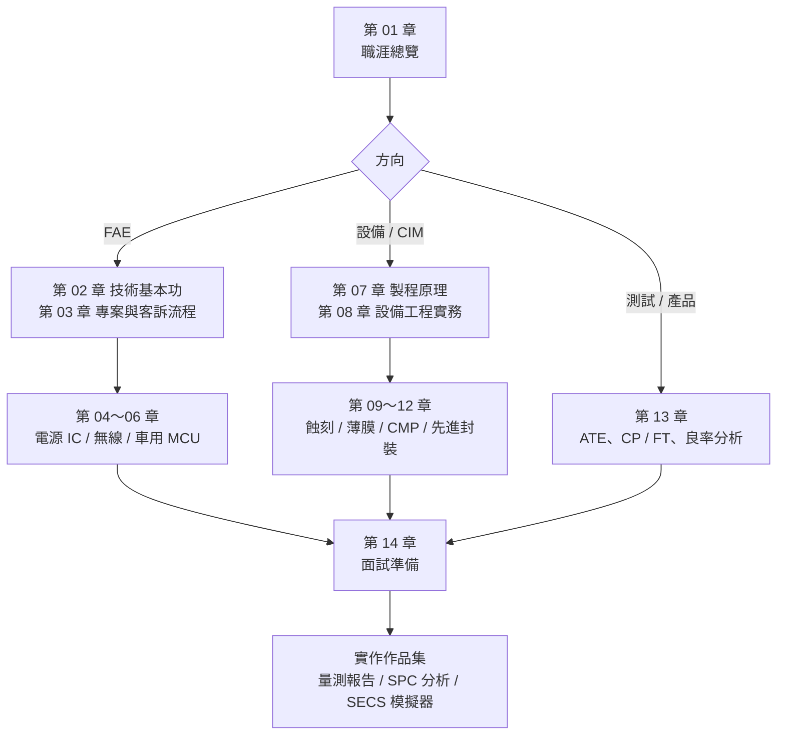

# 01. 硬體相關職涯總覽：FAE、設備、測試與 CIM

> **一句話**：FAE 是「懂技術的客戶問題解決者」，設備工程師是「讓機台穩定量產的人」。兩者的公司內部流程大多是機密，但背後的**電子學、量測、製程、統計與產業標準（JEDEC、IEC、SEMI）是公開且通用的**，這才是面試真正考的東西。

## 學習目標

- 分辨 FAE、AE、設備工程師（EE）、原廠 CE / FSE、測試 / 產品工程師、CIM / EAP 工程師的工作內容
- 了解台灣主要雇主類型與各自的技能需求
- 評估軟體背景轉這些職位的優勢與缺口
- 規劃第 02～14 章的學習順序與求職準備

---

## 1. 先釐清：哪些是機密、哪些是通用 🟢

| 類型 | 例子 | 能否事先學 |
|---|---|---|
| **公司機密** | 製程配方（Recipe）、機台參數、良率數據、內部 SOP、客戶專案、報價 | ❌ 入職後才會接觸 |
| **原廠專屬** | 特定機台的維修手冊、軟體操作、零件編號 | ❌ 通常靠原廠訓練（Training Center） |
| **產業通用** | 半導體製程原理、真空 / 電漿 / RF 基礎、SPC、SECS/GEM、電路與量測、可靠度標準 | ✅ **本站重點** |
| **職能通用** | 問題排查方法（8D、5 Why）、客戶溝通、英文技術文件閱讀、資料分析 | ✅ 面試常考情境題 |

> 面試官知道新人不懂內部流程，他們看的是：**基礎原理懂不懂、遇到問題會不會有條理地排查、能不能承受壓力與輪班、溝通是否清楚**。

## 2. 職位地圖 🟢

| 職位 | 常見雇主 | 一句話 | 核心技能 |
|---|---|---|---|
| **FAE**（Field Application Engineer） | IC 設計公司、外商半導體、代理商 | 協助客戶把自家晶片設計進產品並解決問題 | 電路、量測、韌體 / BSP、溝通 |
| **AE**（Application Engineer） | 同上，偏原廠內部 | 寫參考設計、應用筆記、驗證晶片 | 電路設計、驗證、文件 |
| **設備工程師 EE**（Equipment Engineer） | 晶圓廠、封測廠、面板廠 | 負責機台保養、故障排除、提升稼動率 | 機電整合、真空、電漿、SPC |
| **CE / FSE**（Customer / Field Service Engineer） | 設備原廠（ASML、AMAT、Lam、TEL、KLA 等） | 在客戶晶圓廠內安裝、維修、升級自家機台 | 該機台專業、英文、抗壓 |
| **製程工程師 PE**（Process Engineer） | 晶圓廠 | 負責製程配方與良率 | 物理化學、統計、DOE |
| **測試 / 產品工程師**（TE / PDE） | 封測廠、IC 設計公司 | 寫 ATE 測試程式、分析良率與 Bin | 電路、C++ / Python、資料分析 |
| **CIM / EAP 工程師** | 晶圓廠、封測廠、面板廠、自動化系統商 | 寫連接機台與 MES 的自動化軟體 | **C# / .NET、Java、SECS/GEM、資料庫** |

### 2.1 第三條路：CIM / EAP 工程師 ⭐

對 .NET / MSSQL 背景來說，**CIM**（Computer Integrated Manufacturing）是最直接的橋梁：

- **EAP（Equipment Automation Program）**：透過 **SECS/GEM** 與機台溝通，接收事件與資料、下達配方與指令
- **MES（Manufacturing Execution System）**：管理批次（Lot）流程、派工、追溯
- 常用技術：**C# / .NET**、Java、Oracle / MSSQL、訊息匯流排（如 TIBCO、RabbitMQ、Kafka）、Python 資料分析
- 可先做 CIM 熟悉產線與設備，再轉設備或製程，也能往智慧製造、AI 良率分析發展

> 詳見[第 08 章](08-equipment-engineering-practice.md)的 SECS/GEM 與工廠自動化。

## 3. 台灣主要雇主類型 🟢

| 類型 | 代表公司（舉例） | 適合職位 |
|---|---|---|
| **晶圓代工 / 記憶體** | 台積電、聯電、世界先進、力積電、美光、南亞科、華邦 | EE、PE、CIM |
| **封測** | 日月光、矽品、力成、京元電 | EE、CIM、測試工程師（[第 13 章](13-test-product-engineering.md)） |
| **設備原廠（外商）** | ASML、Applied Materials、Lam Research、TEL、KLA、Screen、DISCO、Advantest | CE / FSE、AE |
| **本土設備 / 零組件** | 弘塑、辛耘、均華、家登、帆宣、漢唐（廠務系統） | EE、AE、FSE |
| **IC 設計** | 聯發科、瑞昱、聯詠、奇景、群聯、新唐、義隆、立錡、矽力杰 | FAE、AE、產品 / 測試工程師 |
| **外商半導體** | TI、ADI、NXP、ST、Infineon、Renesas、Microchip、onsemi、Qualcomm | FAE |
| **電子零件代理商** | 大聯大、文曄、益登、品佳 | FAE（廣度最大） |
| **面板 / 光電** | 友達、群創 | EE、CIM |

## 4. FAE vs 設備工程師：怎麼選 🟡

| 面向 | FAE | 設備工程師（晶圓廠 EE） | 設備原廠 CE |
|---|---|---|---|
| 主要對象 | 外部客戶（系統廠、品牌商） | 內部產線、製程工程師 | 客戶晶圓廠的 EE |
| 技術主軸 | 電路、韌體、訊號、電源 | 機電、真空、電漿、氣體、化學 | 單一機型的深度知識 |
| 工作型態 | 常白天班，但跟著客戶時程與出差 | **常見輪班 / 待命**，故障時要立即處理 | 輪班或待命、駐廠 |
| 壓力來源 | 客戶量產時程、競爭對手 | 機台停機（Down）每分鐘都是產能損失 | 客戶滿意度、機台 Uptime |
| 能力累積 | 廣度高，接觸多種產品與客戶 | 深度高，熟悉量產與統計 | 深度高，常有海外原廠訓練 |
| 英文 | 外商、代理商需求高 | 中等（讀手冊） | **高**（與原廠工程師溝通） |
| 後續發展 | PM、Sales、AE、技術經理 | PE、整合、廠務、管理 | 資深 CE、AE、Account Manager |

## 5. 軟體背景的優勢與缺口 🟡

**優勢**：
- **除錯思維**：拆解問題、假設驗證、二分法排除，與硬體除錯相通
- **自動化與資料分析**：用 Python 分析 Log、FDC 資料、寫自動化腳本，在設備與 FAE 圈都是加分項
- **韌體 / SDK 支援**：FAE 常要協助客戶處理驅動、BSP、SDK 問題，軟體背景是強項
- **系統整合**：SECS/GEM、MES、資料庫、API 是 CIM 的日常

**缺口與補法**：

| 缺口 | 補法 | 對應章節 |
|---|---|---|
| 電子學與電路 | 歐姆定律、RC、電源、MOSFET、運算放大器 | [SWEMindset 21](https://wyc915.github.io/SWEMindset/chapters/21-mcu-hardware)、[02](02-fae-technical-foundation.md) |
| 量測儀器 | 示波器、電源供應器、電子負載、邏輯分析儀實際操作 | [02](02-fae-technical-foundation.md) |
| 半導體製程 | 晶圓製程流程、各站設備原理 | [07](07-semiconductor-process-equipment.md) |
| 統計品管 | SPC、Cpk、管制圖、DOE | [08](08-equipment-engineering-practice.md) |
| 機電與工安 | 氣動、真空、馬達、PLC、LOTO | [07](07-semiconductor-process-equipment.md)、[08](08-equipment-engineering-practice.md) |

## 6. 學習與求職路線 🟡

**作品集建議**（比證照更有說服力）：
- **FAE 方向**：買一塊 EVB（如 STM32 Nucleo、ESP32），寫一份「電源漣波量測 + I²C 波形分析 + 問題排除」的技術報告，模擬給客戶的 Application Note
- **設備 / CIM 方向**：用 C# 或 Python 寫一個 **SECS/GEM（HSMS）模擬器**，或用公開資料集（如 UCI SECOM 半導體製程資料）做 SPC 與異常偵測分析
- 證照可選：TOEIC（外商常要求，約 750 分以上較有競爭力）、電子相關技術士證照可加分但非必要

---

## 動手練習

1. **職缺拆解**：在 104 上搜尋「FAE」「設備工程師」「EAP 工程師」各 5 筆職缺，列出出現頻率最高的 10 個技能關鍵字，對照本章缺口表標記自己已會 / 待補。
2. **選定方向**：依第 4 節比較表，寫下你最在意的 3 個條件（例如輪班、出差、技術深度），決定主攻與備案。
3. **資訊訪談**：透過 LinkedIn 或社群找一位 FAE 或設備工程師，準備 5 個問題（一天的工作、最常遇到的問題、新人最缺什麼）。

## 面試常問

> 先試著自己回答，再對照參考解答。

### Q1. 你是軟體背景，為什麼想轉 FAE / 設備工程師？

回答結構：**動機 → 可轉移能力 → 已做的準備 → 長期目標**。

範例：「我在軟體開發中最有成就感的是排查跨系統的問題，但越來越想理解底層硬體。我的除錯方法、自動化與資料分析能力可以直接帶到 FAE / 設備工作。過去半年我自學了電子學與半導體製程，用 EVB 做了量測與除錯報告（附作品）。長期希望成為能同時處理軟硬體問題的工程師。」

避免：只說「半導體薪水高」「軟體太競爭」。

### Q2. 你認為 FAE 最重要的能力是什麼？

1. **技術理解**：熟悉自家產品與客戶的應用情境，能快速定位問題
2. **溝通與期望管理**：把技術問題翻譯成客戶與業務聽得懂的語言，承諾可做到的時程
3. **問題排查方法**：有系統地縮小範圍，而不是亂猜
4. **跨部門協調**：把客戶問題正確傳遞給 AE、研發、品保，並追蹤到結案

### Q3. 設備工程師需要輪班或 On-call，你可以接受嗎？

誠實回答，並展現理解：「我理解機台停機直接影響產能，所以需要即時支援。我可以接受輪班，也會調整作息與健康管理。」若有限制要事先說清楚，面試時隱瞞反而之後更難處理。

### Q4. 你如何快速學習一個完全不熟的新領域？

1. 先建立**全貌**（流程圖、關鍵名詞）
2. 找出**核心原理**（例如真空、電漿、RF 這幾個貫穿多種設備的基礎）
3. **動手做**並記錄（實驗、量測、筆記）
4. 向資深者請教時**帶著自己的假設**提問
5. 舉一個具體例子：如何自學本知識庫的某個主題

## 常見誤解

- **「FAE 就是技術業務」**：FAE 有業務壓力，但核心價值是**技術**，需要能自己量測、讀電路、改韌體。
- **「設備工程師只是修機台」**：現代 EE 大量使用資料分析（FDC、SPC）與自動化，持續改善稼動率與穩定度。
- **「半導體設備只有電機系能做」**：機械、化工、材料、物理、資工背景都有，重要的是學習能力與基礎觀念。

## 本章回顧

- 內部流程是機密，但**原理、標準、方法論是通用的**，面試考的是這些
- FAE 重廣度與溝通、設備工程師重深度與穩定量產、CIM 是軟體背景最直接的入口
- 準備重點：電子學、量測、半導體製程、SPC、SECS/GEM，加上一份實作作品集
