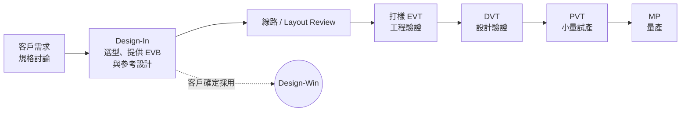
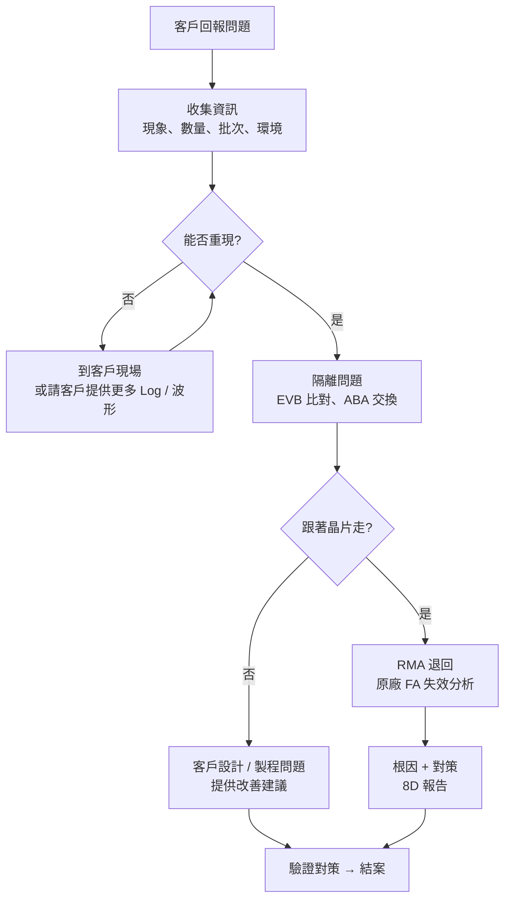

# 03. FAE 實戰：專案流程、客訴處理與品質可靠度

> **一句話**：FAE 的成果不是「回答了多少問題」，而是**幫業務拿下 Design-Win、讓客戶順利量產**。要懂技術，也要懂專案流程、品質流程與溝通。

## 學習目標

- 說明從 Design-In 到量產的專案流程與 FAE 在各階段的角色
- 了解 BOM、Second Source、PCN、EOL 等商務名詞
- 熟悉客訴處理、RMA、失效分析（FA）與 8D 報告
- 了解晶片可靠度測試與車規（AEC-Q100）基礎
- 掌握客戶溝通與問題回報的實用技巧

---

## 1. 專案生命週期 🟢

| 階段 | 客戶在做什麼 | FAE 在做什麼 |
|---|---|---|
| **需求 / 選型** | 比較各家方案 | 介紹產品、提供規格比較、Demo |
| **Design-In** | 開始設計線路 | 提供 EVB、Reference Design、SDK、Layout Guide |
| **Review** | 完成線路圖與 Layout | 檢查線路與 Layout（[第 02 章](02-fae-technical-foundation.md)） |
| **EVT** | 第一版樣品、功能驗證 | 協助 Bring-up、除錯 |
| **DVT** | 規格、環境、可靠度驗證 | 協助處理 EMC、ESD、溫度、效能問題 |
| **PVT** | 小量試產、驗證產線 | 量產燒錄工具、測試程式、良率問題 |
| **MP** | 量產出貨 | 客訴處理、成本降低方案、下一代產品推廣 |

- **Design-Win**：客戶正式選用你的晶片進入產品，是業務與 FAE 最重要的指標
- 從 Design-In 到量產營收常需要**半年到兩年以上**，車用、工控更久

## 2. 必懂商務名詞 🟢

| 名詞 | 白話 |
|---|---|
| **BOM**（Bill of Materials） | 物料清單，客戶最在意總成本 |
| **Second Source** | 第二供應來源，客戶為降低斷料風險會要求可替代料（Pin-to-Pin 相容） |
| **Pin-to-Pin** | 腳位完全相容，可直接替換 |
| **NRE** | 一次性工程費用（如客製化開發） |
| **MOQ / Lead Time** | 最小訂購量 / 交期 |
| **PCN**（Product Change Notification） | 原廠變更產品（製程、封裝、產地）前的正式通知 |
| **EOL / LTB** | 產品停產 / 最後一次購買機會 |
| **Forecast** | 客戶預估用量，影響原廠備貨與報價 |
| **Roadmap** | 產品藍圖，大客戶常簽 NDA 後取得 |
| **NDA** | 保密協議，Datasheet 完整版、Errata、Roadmap 常需 NDA |

### FAE 與其他角色的分工

| 角色 | 主要負責 |
|---|---|
| **Sales / Account Manager** | 客戶關係、報價、訂單、營收 |
| **FAE** | 客戶端技術支援、Design-In、問題排除 |
| **AE** | 原廠內部的應用開發：參考設計、Application Note、驗證 |
| **PM**（Product Manager / Marketing） | 產品規劃、定價、Roadmap |
| **RD** | 晶片設計、韌體與 SDK 開發 |
| **QA / QRA** | 品質、可靠度、客訴與 FA |

## 3. 客訴處理流程 🟡

### 3.1 資訊收集清單（要問的問題）

- **現象**：具體發生什麼？錯誤訊息、波形、Log
- **規模**：不良率多少（例如 3 / 1000）？從何時開始？
- **批次**：晶片的 **Date Code / Lot Number** 是否集中？
- **環境**：溫度、電壓、負載、使用時間
- **變更**：最近改過什麼？韌體、BOM、產線、供應商、PCB 版本
- **重現條件**：能穩定重現嗎？需要多久？

> **「最近改了什麼」往往就是答案**。很多量產突發問題來自客戶換了替代料、產線製程或韌體版本。

### 3.2 失效分析（FA）常見手法

| 手法 | 用途 | 是否破壞 |
|---|---|---|
| **外觀檢查**（光學顯微鏡） | 封裝裂痕、腳位損傷 | 否 |
| **X-Ray** | 打線（Wire Bond）、焊點、內部結構 | 否 |
| **SAT / C-SAM**（超音波掃描） | 封裝內部脫層（Delamination） | 否 |
| **I-V Curve Trace** | 腳位漏電、短路、開路，比對好品 | 否 |
| **Decap**（開封） | 用酸去除封裝看晶粒 | 是 |
| **熱點定位**（如 InGaAs、OBIRCH） | 找漏電燒毀位置 | 是 |
| **SEM / FIB / TEM** | 高倍率觀察、截面分析 | 是 |

常見失效類型：**EOS（過電性應力）**最常見，通常是客戶端電壓突波或熱插拔造成，而非晶片品質問題；其他還有 ESD、封裝脫層、焊接不良等。

### 3.3 8D 報告

| 步驟 | 內容 |
|---|---|
| D1 | 成立團隊 |
| D2 | 描述問題（5W2H） |
| D3 | **暫時圍堵措施**（篩選庫存、隔離批次） |
| D4 | **根本原因分析**（5 Why、魚骨圖） |
| D5 | 選定永久對策 |
| D6 | 執行並驗證對策 |
| D7 | **預防再發**（更新規範、檢查表、FMEA） |
| D8 | 結案與表揚團隊 |

> 根因要分成**發生原因**（為什麼會壞）與**流出原因**（為什麼沒被檢出），兩者都要對策。

## 4. 晶片品質與可靠度 🟡

| 測試 | 目的 |
|---|---|
| **HTOL**（High Temperature Operating Life） | 高溫長時間工作，估算壽命 |
| **ESD**（HBM / CDM） | 元件靜電耐受 |
| **Latch-up** | 抗閂鎖效應 |
| **TC**（Temperature Cycling） | 溫度循環，測封裝與焊點 |
| **HAST / THB** | 高溫高濕，測封裝密封與腐蝕 |
| **MSL**（Moisture Sensitivity Level） | 濕度敏感等級，決定拆封後多久要上件、是否需烘烤 |

**常用指標**：
- **DPPM**（Defect Parts Per Million）：每百萬顆不良數，車用要求極低
- **FIT**：每 10⁹ 元件小時的失效次數
- **浴缸曲線**：早期失效（用 Burn-in 篩除）→ 隨機失效 → 磨耗失效

**車規**：
- **AEC-Q100**：車用 IC 的可靠度驗證標準，依溫度分 Grade 0（-40～150°C）到 Grade 3（-40～85°C）
- **IATF 16949**：車用品質管理系統
- **ISO 26262**：車用功能安全（ASIL 等級），影響晶片設計與文件要求
- **PPAP**：量產零件核准程序，車廠要求供應商提交的文件包

## 5. 溝通與工作方法 🟡

**回報給客戶**：
- 先給**結論與下一步**，再給細節
- 承諾要具體：「明天下午三點前給初步分析」優於「我們盡快」
- 不確定時說「目前假設是 X，正在用 Y 方法驗證」，不要亂猜

**回報給原廠 RD / AE**（問題升級 Escalation）：
- 一份好的問題報告包含：**環境（晶片型號、版本、SDK 版本）、重現步驟、預期與實際結果、已排除的項目、波形與 Log、影響範圍（客戶、數量、時程）**
- 這跟軟體的 Bug Report 一樣，軟體背景在這點有天然優勢

**知識管理**：
- 建立自己的**案例庫**（問題、根因、解法），FAE 的價值會隨案例累積而成長
- 常見問題整理成 FAQ 或 Application Note，減少重複支援

**FAE 的時間分配常見挑戰**：同時支援多個客戶，要依**營收影響、量產時程、問題嚴重度**排優先順序，並讓業務知道取捨。

---

## 動手練習

1. **寫一份 8D 報告**：以你在軟體工作中遇過的一個線上事故為例，用 8D 格式重寫，特別區分發生原因與流出原因。
2. **模擬客訴**：假設「客戶量產後 0.5% 產品藍牙連不上」，寫下你要問客戶的 10 個問題與排查計畫。
3. **讀可靠度報告**：在 TI 或 ST 官網下載任一顆 IC 的 Reliability Report 或 Qualification Report，找出 HTOL 條件、樣本數與 FIT 值。
4. **比較 Second Source**：選一顆常見的 LDO，找兩家 Pin-to-Pin 相容的替代料，比較規格差異並判斷能否直接替換。

## 面試常問

> 先試著自己回答，再對照參考解答。

### Q1. 什麼是 Design-Win？FAE 如何幫助取得？

Design-Win 是客戶正式選用自家晶片進入產品設計。FAE 的貢獻：
- 快速提供 **EVB、參考設計、Demo**，降低客戶評估成本
- 針對客戶應用做**技術比較**，突顯差異化（功耗、成本、整合度）
- 前期**線路 / Layout Review**，讓客戶第一版就成功
- 開發階段反應快、問題解得快，建立客戶信任

### Q2. 客戶量產後突然出現大量不良，你怎麼處理？

1. **先止血**：與客戶確認影響範圍，建議**暫時圍堵**（隔離批次、篩選）
2. **收集資訊**：不良率、Date Code / Lot、時間點、最近變更（韌體、BOM、產線）
3. **重現與隔離**：取不良品與良品，做 ABA 交換、EVB 比對
4. **判斷歸屬**：跟著晶片 → RMA 走 FA；跟著板子 → 協助客戶查製程或設計
5. **根因與對策**：8D 報告，並追蹤對策驗證到結案
6. 全程**定期回報進度**給客戶與業務

### Q3. 客戶堅持是晶片問題，但你的分析顯示是客戶設計問題，怎麼溝通？

- 用**數據與實驗**說話：EVB 正常、ABA 交換結果、波形比對
- 不說「是你們的問題」，而是「我們發現在這個條件下電源下陷到 X，低於規格的 Y，建議調整 Z，我們可以協助驗證」
- 提供**具體改善方案**，把焦點放在「一起解決」
- 必要時請原廠 AE 或 QA 共同出具報告

### Q4. 8D 的 D3 和 D5 有什麼差別？

- **D3 暫時圍堵**：問題根因找到前，先防止不良流到客戶手上（例如全檢、隔離批次、換料）
- **D5 / D6 永久對策**：針對根本原因的長期解法（例如修改設計、製程參數、韌體）

暫時措施通常成本高、不可持續，永久對策驗證有效後才能解除暫時措施。

### Q5. 收到 PCN 時，客戶通常需要做什麼？

評估變更內容（製程、封裝、產地、材料）對產品的影響，決定是否需要**重新驗證**（功能、可靠度、甚至車規 PPAP），並規劃庫存切換時間。FAE 要協助解釋變更內容、提供可靠度資料，並追蹤客戶的驗證進度。

### Q6. 什麼是 EOS？與 ESD 有什麼不同？

- **ESD**：極短時間（奈秒級）、高電壓的靜電放電
- **EOS（Electrical Overstress）**：較長時間（微秒到秒級）超出規格的電壓或電流，常見於熱插拔、電源突波、反接、感性負載

FA 時 EOS 常見**大面積燒毀、金屬熔化**的痕跡，通常代表客戶端使用條件超出規格，需檢查保護電路與上電程序。

## 常見誤解

- **「FAE 只要技術強就好」**：專案流程、商務理解與溝通同樣重要，否則技術對了也拿不到 Design-Win。
- **「客訴都是原廠的錯」**：多數 FA 結果是 EOS 或應用問題，但 FAE 要用數據證明，並協助客戶改善。
- **「8D 報告是形式」**：做得好的 8D 能避免同樣問題在其他客戶重演，D7 預防再發最有價值。

## 本章回顧

- 專案流程：Design-In → EVT → DVT → PVT → MP，Design-Win 是關鍵指標
- 客訴處理：收集資訊 → 重現 → 隔離（EVB、ABA）→ FA → 8D
- 可靠度：HTOL、ESD、TC、HAST、MSL；車規看 AEC-Q100、IATF 16949、ISO 26262
- 溝通：先結論後細節、承諾要具體、用數據說話
