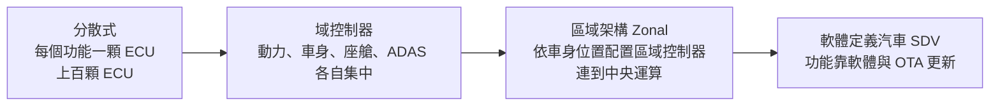
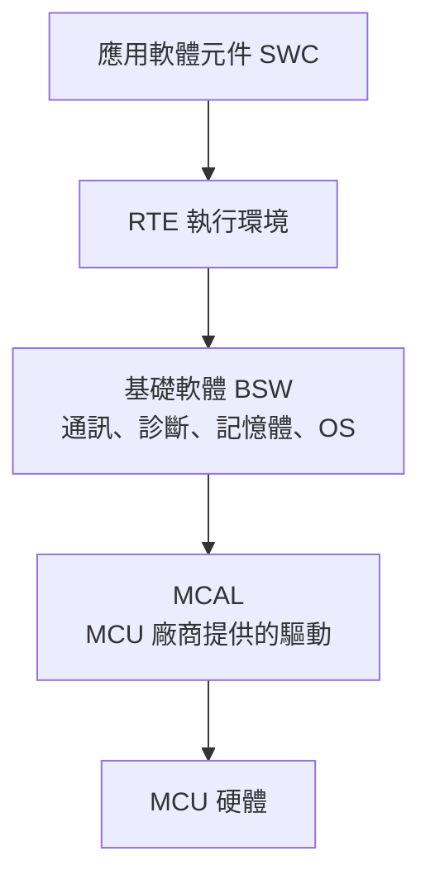

# 06. FAE 產品線實務（三）：車用 MCU

> **一句話**：車用 MCU 的 FAE 除了技術支援，更多時間花在**功能安全（ISO 26262）、資安（ISO/SAE 21434）、AUTOSAR、車用網路與品質文件**上。專案週期長、文件要求嚴，但產品生命週期長、客戶黏著度高。

## 學習目標

- 了解車用電子架構從分散式 ECU 走向區域（Zonal）與中央運算的趨勢
- 熟悉車用網路：CAN / CAN FD、LIN、車用乙太網路
- 理解 ISO 26262 功能安全與 MCU 的安全機制
- 了解車用資安法規（UN R155 / R156、ISO/SAE 21434）與 HSM
- 認識 AUTOSAR、MCAL、UDS 診斷與燒錄
- 能排查 CAN Bus-off、低功耗、EMC 與電源暫態等常見問題

---

## 1. 車用電子架構演進 🟢

- **區域控制器**負責收集附近感測器與致動器、供電分配，透過**車用乙太網路**連到中央運算單元
- **SDV（Software-Defined Vehicle）**：硬體平台化、功能軟體化，OTA 更新成為常態
- MCU 主要廠商：Infineon（AURIX）、NXP（S32 系列）、Renesas（RH850 等）、ST、TI、Microchip

## 2. 車用網路 🟡

| 網路 | 速度 | 特性 | 用途 |
|---|---|---|---|
| **CAN** | 最高 1Mbps | 差動、多主、ID 仲裁 | 動力、車身、底盤 |
| **CAN FD** | 資料段可達數 Mbps | 每幀最多 **64 bytes** 資料 | 新一代 ECU、診斷燒錄加速 |
| **CAN XL** | 更高速度與更長資料 | 銜接 CAN 與乙太網路 | 新興 |
| **LIN** | 約 20kbps | 單線、主從式、低成本 | 車窗、座椅、後視鏡 |
| **FlexRay** | 10Mbps | 時間觸發、確定性 | 舊一代線控、底盤（逐漸被乙太網路取代） |
| **車用乙太網路** | 10M～數 Gbps | **單對雙絞線**（如 100BASE-T1、1000BASE-T1、10BASE-T1S） | 區域架構骨幹、攝影機、座艙 |

**CAN 實務重點**：
- 匯流排兩端各一個 **120Ω 終端電阻**，斷電時量 CAN_H 與 CAN_L 間約 **60Ω**
- **位元時序**：取樣點（Sample Point）常設在約 75～87.5%，同一網路的節點要一致
- **錯誤處理**：每個節點有發送 / 接收錯誤計數器（TEC / REC）
  - 超過 127 → **Error Passive**
  - TEC 超過 255 → **Bus-off**（節點離線），需依規則恢復
- 車用網路上層常用 **SOME/IP**（服務導向通訊，乙太網路）與 **UDS**（診斷）

## 3. 功能安全：ISO 26262 🔴

- **ASIL 等級**：A（最低）到 **D（最高）**，依危害的嚴重度、暴露機率、可控性決定；例如煞車、轉向常要求 ASIL D
- MCU 廠商提供：**Safety Manual**（使用條件）、**FMEDA**（失效模式與診斷涵蓋率分析）、**Safety Case** 相關文件
- 關鍵指標：**SPFM**（單點故障指標）、**LFM**（潛伏故障指標）、**PMHF**（隨機硬體失效機率）

**MCU 常見安全機制**：

| 機制 | 作用 |
|---|---|
| **Lockstep 核心** | 兩顆核心執行相同指令並比對結果，偵測運算錯誤 |
| **ECC** | Flash 與 RAM 錯誤更正 / 偵測 |
| **硬體 BIST** | 開機或執行中自我測試（LBIST、MBIST） |
| **視窗型看門狗** | 太早或太晚餵狗都視為錯誤 |
| **時脈監控** | 偵測時脈遺失或頻率異常 |
| **電壓監控** | 過壓 / 欠壓偵測 |
| **MPU / 記憶體保護** | 隔離不同 ASIL 等級的軟體 |
| **錯誤管理模組** | 集中收集錯誤並觸發安全反應（如進入安全狀態） |

> FAE 常被問：「這個安全機制要怎麼設定才能達到 ASIL D？」答案在 Safety Manual 的**假設使用條件（Assumptions of Use）**，客戶的軟體必須照著做。

## 4. 車用資安 🔴

| 規範 | 內容 |
|---|---|
| **UN R155** | 車廠必須建立**網路安全管理系統（CSMS）**，歐盟等地區新車型核准的要求 |
| **UN R156** | 車廠必須建立**軟體更新管理系統（SUMS）**，規範 OTA |
| **ISO/SAE 21434** | 車用網路安全工程標準：威脅分析與風險評估（TARA）、開發流程 |

**MCU 的資安功能**：
- **HSM（Hardware Security Module）**：獨立安全核心，負責金鑰保存、加解密、安全開機
- **Secure Boot**、**加密加速器**（AES、SHA、ECC）、**真亂數產生器（TRNG）**
- **SecOC**：AUTOSAR 定義的車內訊息認證，防止偽造 CAN 訊息
- **除錯介面保護**：量產後鎖定 JTAG / SWD

## 5. 軟體生態：AUTOSAR、MISRA、ASPICE 🟡

| 名詞 | 說明 |
|---|---|
| **AUTOSAR Classic** | 傳統 ECU 的分層軟體架構，跑在 MCU 上 |
| **AUTOSAR Adaptive** | 高效能運算平台（POSIX 系統）的服務導向架構 |
| **MCAL** | 微控制器抽象層，**由 MCU 廠商提供**，FAE 最常支援的部分 |
| **MISRA C** | 車用 C 語言編碼規範 |
| **ASPICE** | 汽車軟體開發流程成熟度評估，Tier 1 供應商常被要求 |

## 6. 診斷與燒錄 🟡

- **UDS（ISO 14229）**：車用診斷協定，例如讀故障碼（DTC）、讀寫資料、**安全存取（Security Access）**、**刷寫韌體**
- 傳輸層：CAN 上用 **ISO-TP**（ISO 15765-2）分段傳送，乙太網路上用 **DoIP**
- **Bootloader 刷寫流程**：進入程式模式 → 安全存取 → 抹除 → 下載 → 驗證 → 重置
- **OTA**：常用 **A/B 分區**，更新失敗可回復（參考 [SWEMindset 第 23 章](https://wyc915.github.io/SWEMindset/chapters/23-firmware-debug-test-release)）
- **Data Flash / EEPROM 模擬**：儲存設定與故障紀錄，要注意**寫入次數壽命**與斷電保護

## 7. 車用環境與品質要求 🟡

| 項目 | 說明 |
|---|---|
| **溫度** | AEC-Q100 Grade 1（−40～125°C）常見，引擎室需更高（見[第 03 章](03-fae-business-support.md)） |
| **電源暫態** | 冷啟動（Cold Crank）電壓驟降、**拋負載**（Load Dump）高壓突波，參考 ISO 16750-2、ISO 7637-2 |
| **EMC** | 車用常用 **CISPR 25**（零組件發射）、ISO 11452（抗擾）系列 |
| **靜態電流** | 熄火後 ECU 待機電流要非常低，否則電池會被放光 |
| **長期供貨** | 車用 MCU 常承諾 **10～15 年**供貨 |
| **品質** | 目標 **零缺陷（Zero DPPM）**、PPAP、PCN 嚴格管理 |

## 8. 常見客訴與排查 🔴

| 現象 | 可能原因 | 排查 |
|---|---|---|
| **CAN Bus-off** | 終端電阻錯誤、位元時序不一致、線材 / 接頭、收發器電源、雜訊 | 量 60Ω、比對各節點取樣點、示波器看差動波形、讀 TEC / REC |
| **熄火後電池被放光** | 某周邊沒關、喚醒來源設定錯、收發器沒進睡眠 | 量各電源軌電流、逐一關閉周邊、檢查喚醒來源 |
| **冷啟動時重開機** | 電壓驟降低於 MCU 或電源 IC 的 UVLO | 用電源模擬器重現 Cold Crank 波形 |
| **Watchdog 重置** | 視窗設定、任務被長中斷卡住 | 檢查最長中斷時間、餵狗位置 |
| **Flash ECC 錯誤** | 刷寫流程中斷、Data Flash 寫入過多 | 讀錯誤位址、檢查寫入頻率與刷寫流程 |
| **EMC 不過** | 時脈、DC-DC、CAN 收發器周邊濾波 | 展頻時脈、共模扼流圈、Layout |
| **MCAL 設定問題** | 時脈樹、Port、中斷優先權設定錯 | 對照 MCAL 設定工具與 Errata |

---

## 動手練習

1. **CAN 實驗**：用兩塊支援 CAN 的開發板（如 STM32 + 收發器模組）建立網路，故意拿掉終端電阻或改變位元時序，觀察錯誤計數與 Bus-off。
2. **用 Linux SocketCAN**：在 Linux 上建立虛擬 CAN（`vcan`），用 `cansend`、`candump` 練習收發，並嘗試送出一個 UDS 請求（如 `0x22` 讀資料）。
3. **讀 Safety Manual**：下載任一車用 MCU 的公開安全文件或產品簡介，列出它提供的安全機制並對照本章表格。
4. **ASIL 練習**：選一個車用功能（如電動車窗防夾、煞車燈），用嚴重度 / 暴露度 / 可控性推估可能的 ASIL 等級。

## 面試常問

> 先試著自己回答，再對照參考解答。

### Q1. CAN 為什麼需要 120Ω 終端電阻？

CAN 是高速差動傳輸線，特性阻抗約 120Ω。兩端加上 120Ω 終端可**吸收訊號，避免反射**造成位元錯誤，也讓顯性 / 隱性電位正確建立。斷電時在匯流排上量到約 60Ω（兩個 120Ω 並聯）表示終端正確；量到 120Ω 代表少一個，量到約 40Ω 代表多一個。

### Q2. 什麼是 CAN Bus-off？如何恢復？

每個 CAN 節點有發送錯誤計數器（TEC）與接收錯誤計數器（REC）。發送錯誤會讓 TEC 增加，**TEC 超過 255 時節點進入 Bus-off**，停止參與通訊，避免故障節點癱瘓整個網路。恢復需在匯流排上偵測到 **128 次連續 11 個隱性位元**後才能重新加入，實務上應用層也會定義恢復策略（例如快速恢復幾次後改慢速恢復並記錄 DTC）。

### Q3. ASIL D 的 MCU 通常有哪些安全機制？

Lockstep 雙核心比對、Flash / RAM 的 ECC、開機與執行中的 BIST、視窗型看門狗、時脈與電壓監控、記憶體保護單元、集中式錯誤管理模組。並提供 Safety Manual 與 FMEDA，客戶必須依照**假設使用條件**設定，整個系統才能達到 ASIL D。

### Q4. MCAL 是什麼？FAE 常遇到哪些問題？

MCAL（Microcontroller Abstraction Layer）是 AUTOSAR 中最底層的驅動，由 MCU 廠商提供，讓上層 BSW 不必直接操作暫存器。常見問題：時脈與 PLL 設定、Port 腳位多工、中斷優先權、DMA 設定、版本與 AUTOSAR 工具鏈相容性、Errata 導致的行為差異。

### Q5. 熄火後車輛電池被放光，可能是哪個 ECU？怎麼查？

1. 量測整車靜態電流，**逐一拔除保險絲**找出耗電異常的迴路
2. 對可疑 ECU 量各電源軌電流，確認 MCU 是否真的進入低功耗模式
3. 檢查**喚醒來源**：CAN / LIN 網路是否有節點持續送訊息讓其他 ECU 無法睡眠
4. 檢查周邊與收發器是否進入睡眠、GPIO 是否有漏電路徑

### Q6. 車用與消費性 MCU 的 FAE 工作差在哪？

- **週期**：車用專案從開發到量產常需數年
- **文件**：功能安全、資安、PPAP、AEC-Q100 報告等大量文件
- **品質**：零缺陷目標，客訴處理更嚴格（8D 時程要求）
- **軟體**：AUTOSAR、MISRA、ASPICE 流程
- **供貨**：長期供貨承諾，PCN 影響大

## 常見誤解

- **「用了 ASIL D 的 MCU，系統就是 ASIL D」**：功能安全是**系統層級**，需要硬體、軟體、流程共同達成。
- **「CAN 已經過時」**：CAN / CAN FD 仍是車上數量最多的網路，乙太網路主要用在骨幹與高頻寬應用。
- **「資安只是加密」**：車用資安涵蓋 TARA、開發流程、金鑰管理、OTA 與整個生命週期的漏洞管理。

## 本章回顧

- 架構演進：分散式 → 域控制 → 區域架構 → SDV
- 網路：CAN / CAN FD（120Ω、取樣點、Bus-off）、LIN、車用乙太網路
- 功能安全：ASIL A～D、Lockstep、ECC、視窗看門狗、Safety Manual
- 資安：UN R155 / R156、ISO/SAE 21434、HSM、SecOC
- 軟體：AUTOSAR、MCAL、UDS 刷寫；車用環境：Cold Crank、Load Dump、CISPR 25、靜態電流
