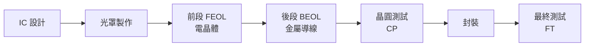
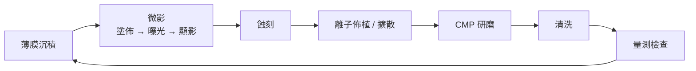
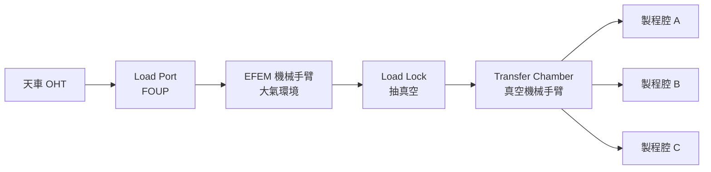

# 07. 半導體製程與設備原理

> **一句話**：一片晶圓要經過**數百到上千道步驟**，但核心只有幾種動作反覆循環：**長膜、曝光、蝕刻、摻雜、研磨、清洗、量測**。搞懂每一站的原理與共通子系統（真空、電漿、RF、氣體、溫控），就能看懂大部分設備。

## 學習目標

- 說出晶圓前段製程的主要模組與循環
- 理解微影、蝕刻、薄膜、離子佈植、CMP、清洗、量測設備的原理
- 掌握設備共通子系統：真空、電漿與 RF、氣體輸送、溫控、晶圓傳送
- 了解先進製程與先進封裝的趨勢
- 認識主要設備廠商與其強項

---

## 1. 晶圓製造全貌 🟢

- **FEOL**（Front-End-of-Line）：在矽上做出電晶體
- **MEOL / BEOL**：做接點與多層金屬導線，先進製程可達十多層以上
- 主要製程模組在晶圓上**重複循環**：

晶圓廠常依此分成模組部門：**Photo（黃光）、Etch、Thin Film（CVD / PVD / ALD）、Diffusion（爐管、佈植）、CMP、Wet（濕式清洗）**，以及量測與良率。設備工程師通常歸屬其中一個模組。

## 2. 各站設備原理 🟡

### 2.1 微影（Lithography / Photo）

| 項目 | 說明 |
|---|---|
| 流程 | **塗佈光阻 → 軟烤 → 曝光 → 曝後烤（PEB）→ 顯影**，塗佈與顯影由 **Track**（如 TEL）負責 |
| 光源 | i-line 365nm、**KrF 248nm**、**ArF 193nm**（乾式與**浸潤式** ArFi）、**EUV 13.5nm** |
| 解析度 | Rayleigh 公式 `CD = k1 × λ / NA`，降低波長、提高 NA、降低 k1（多重曝光、OPC） |
| 關鍵指標 | **CD**（線寬）、**Overlay**（層與層的對準誤差）、Focus / Dose |
| 設備 | 曝光機以 **ASML** 為主（EUV 唯一供應商），Nikon、Canon 在 DUV / i-line 市場 |

- **EUV**：光在空氣中會被吸收，需真空環境與反射式光學（多層膜反射鏡），光源由雷射打擊錫液滴產生電漿
- **High-NA EUV**：NA 從 0.33 提升到 0.55，進一步提高解析度，正由先進邏輯與記憶體廠導入評估

### 2.2 蝕刻（Etch）

| 類型 | 原理 | 特性 |
|---|---|---|
| **濕式蝕刻** | 化學溶液 | 等向性（側向也會蝕刻），用於清洗或去除整層 |
| **乾式蝕刻（電漿）** | 電漿中的離子與自由基 | **非等向性**，能做出垂直側壁，主流 |
| **ALE**（原子層蝕刻） | 自限性反應，一次去除一層原子 | 精度最高，用於先進製程 |

- 電漿源：**CCP**（電容耦合）、**ICP**（感應耦合）
- 關鍵指標：蝕刻速率、**選擇比**（Selectivity）、均勻性、輪廓、**終點偵測**（Endpoint，常用 **OES** 光譜監測）
- 主要廠商：**Lam Research**、**TEL**、**Applied Materials**

### 2.3 薄膜沉積（Thin Film）

| 類型 | 原理 | 用途 |
|---|---|---|
| **CVD**（化學氣相沉積） | 氣體反應生成薄膜；PECVD 用電漿降低溫度 | 介電層（SiO₂、SiN） |
| **PVD**（物理氣相沉積 / 濺鍍） | 離子撞擊靶材，原子飛到晶圓 | 金屬層、阻障層（Ti、TiN、Cu Seed） |
| **ALD**（原子層沉積） | 兩種前驅物輪流通入，每次長一層 | 超薄、高均勻、高階梯覆蓋（High-k、先進電晶體） |
| **Epitaxy**（磊晶） | 在單晶上長出同晶向的晶體 | 源 / 汲極、SiGe 應變層 |
| **ECP**（電鍍） | 電化學沉積銅 | 銅導線（大馬士革製程） |

主要廠商：**Applied Materials**（PVD、CVD、Epi 強項）、Lam（CVD、ALD、電鍍）、TEL、ASM International（ALD、Epi）、Kokusai（爐管）。

### 2.4 離子佈植與熱製程（Diffusion）

- **離子佈植（Implant）**：把摻雜離子（如 B、P、As）加速打入矽中，控制**劑量（Dose）與能量（深度）**；主要廠商 Applied Materials、Axcelis
- **爐管（Furnace）**：批次高溫製程，如氧化、退火、LPCVD
- **RTP / 退火**：快速升溫，活化摻雜並修復晶格損傷，熱預算（Thermal Budget）控制是關鍵

### 2.5 CMP（化學機械研磨）

- 用**研磨液（Slurry）+ 研磨墊（Pad）+ 壓力與旋轉**把表面磨平，讓下一層微影能對焦
- 關鍵耗材與參數：Slurry、Pad、**Pad Conditioner（鑽石碟）**、下壓力、轉速
- 常見問題：**Dishing（碟化）、Erosion（侵蝕）**、刮傷、殘留
- 終點偵測：馬達電流、光學、渦電流
- 主要廠商：**Applied Materials**、Ebara

### 2.6 濕式清洗（Wet Clean）

- 每道製程前後都要清洗，去除微粒、有機物、金屬污染
- 經典配方：**RCA 清洗**（SC1：NH₄OH + H₂O₂ + H₂O 去微粒與有機物；SC2：HCl + H₂O₂ + H₂O 去金屬）、**DHF**（稀釋氫氟酸）去氧化層
- 單片式（Single Wafer）逐漸取代批次式；主要廠商 **SCREEN**、TEL、Lam、本土如辛耘、弘塑

### 2.7 量測與檢查（Metrology / Inspection）

| 設備 | 量什麼 |
|---|---|
| **CD-SEM** | 線寬 |
| **OCD**（光學散射量測） | 3D 結構尺寸，非破壞、快速 |
| **橢圓偏光儀（Ellipsometer）** | 薄膜厚度與光學常數 |
| **Overlay 量測** | 層間對準誤差 |
| **缺陷檢測**（明場、暗場、電子束） | 微粒、圖形缺陷 |
| **缺陷複檢（Review SEM）** | 確認缺陷類型 |

主要廠商：**KLA**（市占領先）、Applied Materials、Hitachi High-Tech、Onto Innovation。

## 3. 設備共通子系統（設備工程師的真正基本功）🟡

不同機台的製程不同，但**子系統大同小異**，學會這些就能快速上手新機台。

### 3.1 真空系統

| 元件 | 用途 |
|---|---|
| **乾式幫浦（Dry Pump）** | 粗抽，從大氣壓抽到低真空 |
| **渦輪分子幫浦（Turbo Pump）** | 高真空，需前級幫浦支援 |
| **低溫幫浦（Cryo Pump）** | 超高真空，常見於 PVD、佈植 |
| **電容式真空計（Capacitance Manometer）** | 精準量製程壓力，與氣體種類無關 |
| **Pirani / 離子真空計** | 粗真空 / 高真空量測 |
| **節流閥（Throttle Valve）** | 控制腔體壓力（壓力閉迴路） |

**常見問題**：**漏氣（Leak）**→ 用**氦氣測漏儀**（He Leak Detector）找漏點、做 **Rate-of-Rise** 測試；O-ring 老化；幫浦異常（電流、溫度、震動上升）。

### 3.2 電漿與 RF

- **電漿**：氣體被電場游離成離子、電子、自由基，用於蝕刻、PECVD、清潔腔體
- **RF 產生器**：常用 **13.56MHz**（工業科學醫療頻段），也有 2MHz、60MHz 等多頻組合控制離子能量與密度
- **匹配器（Matching Network）**：讓負載阻抗匹配 50Ω，降低**反射功率（Reflected Power）**；反射功率異常是常見警報
- **靜電吸盤（ESC）**：用靜電吸住晶圓，背面通**氦氣**幫助散熱；常見問題為吸附力下降、氦氣漏率上升

### 3.3 氣體輸送

- **MFC（質量流量控制器）**：精準控制每種製程氣體流量，飄移會直接影響製程
- **氣體櫃（Gas Cabinet / VMB）**：特殊氣體（毒性、可燃、腐蝕）的供應與安全連鎖
- 尾氣處理：**Scrubber / Abatement** 處理有害廢氣

### 3.4 溫控與其他

- **Chiller / Heat Exchanger**：控制腔體與吸盤溫度
- **加熱器、熱電偶、RTD**
- **PLC、馬達、氣動閥、感測器、安全連鎖（Interlock）**：機電整合基礎

### 3.5 晶圓傳送與自動化

| 名詞 | 說明 |
|---|---|
| **FOUP** | 300mm 晶圓的密封傳送盒，一盒最多 25 片 |
| **Load Port** | 機台上放置與開啟 FOUP 的介面 |
| **EFEM** | 設備前端模組，內含機械手臂在大氣環境取放晶圓 |
| **Load Lock** | 大氣與真空之間的緩衝腔 |
| **Transfer Chamber / Robot** | 真空中把晶圓送進各製程腔（Cluster Tool 架構） |
| **AMHS / OHT** | 廠內自動物料搬運系統 / 天車，在機台間運送 FOUP |

常見問題：**機械手臂教點（Teaching）偏移**、晶圓破片、Mapping 錯誤、FOUP 對位問題。

## 4. 無塵室與廠務 🟢

- **無塵室等級**：依 **ISO 14644-1** 分級，黃光區要求最嚴格；人員要穿無塵衣、遵守動線
- **廠務系統**：超純水（UPW）、特殊氣體、化學品供應、排氣、廢水處理、電力與空調
- **AMC**（氣態分子污染）：微量化學物質就會影響良率，尤其黃光區

## 5. 先進製程與先進封裝趨勢 🔴

| 趨勢 | 說明 | 對設備的影響 |
|---|---|---|
| **GAA 電晶體（Nanosheet）** | 閘極全面包覆通道，取代 FinFET，2nm 世代導入 | 需更多 ALD、選擇性蝕刻、磊晶 |
| **背面供電（Backside Power）** | 電源線移到晶圓背面，釋放正面繞線空間 | 晶圓鍵合、薄化、背面製程 |
| **High-NA EUV** | 更高解析度 | 新曝光機、光阻、量測 |
| **先進封裝**（CoWoS、InFO、SoIC、HBM） | 多晶片整合，AI 晶片關鍵 | **混合鍵合（Hybrid Bonding）**、TSV、CMP、切割、研磨需求大增 |
| **3D NAND 層數增加** | 數百層堆疊 | 高深寬比蝕刻與沉積 |
| **智慧製造** | FDC、預測保養、AI 良率分析 | 設備資料收集（Interface A / EDA）與分析能力 |

> AI 晶片需求讓**先進封裝**成為擴產重點，封裝相關設備（鍵合機、切割機、研磨機）與 CoWoS 產線的設備工程師需求明顯增加。

---

## 動手練習

1. **畫製程流程**：用本章 Mermaid 圖的循環，描述一個 CMOS 反相器從 Wafer 到金屬導線的主要步驟（可參考公開的教科書或線上課程，如 MIT OCW、交大 / 清大開放式課程）。
2. **公式練習**：ArFi（λ = 193nm、NA = 1.35、k1 = 0.28）與 EUV（λ = 13.5nm、NA = 0.33、k1 = 0.4）分別計算最小 CD，比較差異。
3. **讀年報**：閱讀 ASML、Applied Materials、Lam Research 最新年報或投資人簡報，整理各家主要產品線與營收占比。
4. **真空小實驗**：若有機會參觀大學實驗室或真空設備，觀察 Pump Down 曲線與真空計讀值變化。

## 面試常問

> 先試著自己回答，再對照參考解答。

### Q1. 請簡述晶圓製程的主要步驟

薄膜沉積 → 微影（塗佈、曝光、顯影）→ 蝕刻 → 離子佈植 / 擴散 → CMP → 清洗 → 量測，**這個循環重複數十次**，先在 FEOL 做出電晶體，再於 BEOL 做多層金屬導線，最後經晶圓測試、封裝與最終測試。

### Q2. 乾式蝕刻與濕式蝕刻的差別？

- **濕式**：化學溶液、等向性、選擇比高、便宜，但無法做細微垂直結構，主要用於清洗或整層去除
- **乾式（電漿）**：離子轟擊 + 化學反應，**非等向性**，能做出垂直側壁與奈米級圖形，是先進製程主流

### Q3. CVD、PVD、ALD 的差別？

- **CVD**：氣體化學反應成膜，速度快，用於介電層
- **PVD**：物理濺鍍靶材，主要用於金屬層，階梯覆蓋較差
- **ALD**：前驅物輪流通入、自限性反應，每循環長一層原子，**厚度控制精準、覆蓋性極佳**但速度慢，用於超薄高介電層與先進結構

### Q4. 為什麼 EUV 需要真空？

13.5nm 的 EUV 光會被空氣與幾乎所有材料強烈吸收，因此光路必須在真空中，且只能用**多層膜反射鏡**而非透鏡，光罩也是反射式。

### Q5. RF 反射功率過高代表什麼？怎麼處理？

代表電漿負載的阻抗與 RF 產生器（50Ω）不匹配，能量無法有效傳入電漿。可能原因：匹配器故障或調整範圍不足、腔體狀況改變（沉積物、零件老化）、電漿點火異常、氣體或壓力異常、RF 線材接觸不良。處理：查看匹配器電容位置（Tune / Load）趨勢、檢查壓力與氣流、檢查 RF 連接與腔體零件，必要時執行腔體保養。

### Q6. 如何判斷真空腔體有漏氣？

1. **Rate-of-Rise 測試**：抽到底壓後關閉閥門，觀察壓力上升速率，超過規格表示有漏或內部釋氣
2. **底壓**（Base Pressure）比平常高
3. 用**氦氣測漏儀**噴氦氣在疑似位置（O-ring、法蘭、閥門），找出漏點
4. 區分**真漏**（外部洩漏）與**虛漏（內部釋氣，如水氣、殘留物）**：虛漏常在長時間抽氣或烘烤後改善

### Q7. CMP 的目的與常見問題？

目的是**全面平坦化**，讓後續微影能對焦、多層導線能堆疊。常見問題：碟化（Dishing，軟金屬中間凹陷）、侵蝕（Erosion，密集圖形區被過度研磨）、刮傷、Slurry 殘留、研磨均勻度飄移（Pad 或 Conditioner 磨耗）。

## 常見誤解

- **「製程越小只是把東西縮小」**：先進製程需要新結構（GAA）、新材料與新設備，不只是等比例縮小。
- **「設備工程師要懂所有製程」**：通常專精一個模組，但真空、電漿、RF、機電等**共通子系統**要扎實。
- **「EUV 取代了所有 DUV」**：只有最關鍵的層用 EUV，大量層仍使用 ArFi、KrF 等 DUV 曝光。

## 本章回顧

- 製程循環：長膜 → 微影 → 蝕刻 → 摻雜 → CMP → 清洗 → 量測
- 共通子系統：**真空、電漿與 RF、氣體（MFC）、溫控、晶圓傳送**
- 主要廠商：ASML（微影）、AMAT（薄膜、CMP、佈植）、Lam（蝕刻、沉積）、TEL（Track、蝕刻）、KLA（量測）
- 趨勢：GAA、背面供電、High-NA EUV、先進封裝與混合鍵合
