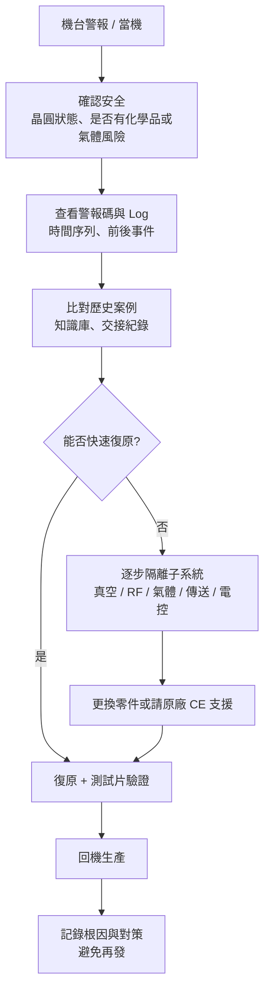
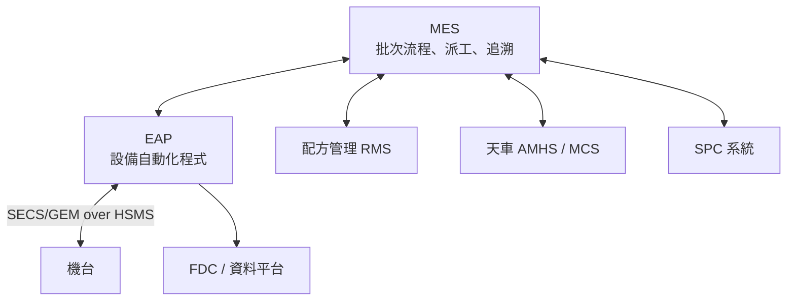
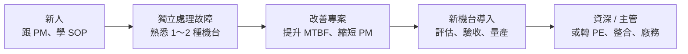

# 08. 設備工程實務：稼動率、SPC、SECS/GEM 與工安

> **一句話**：設備工程師的 KPI 是**機台穩定可用**：減少當機、縮短維修時間、讓製程參數不飄移。日常工作是**保養、排除故障、看數據、持續改善**，而這些背後有一套業界通用的指標與標準（SEMI E10、SPC、SECS/GEM、SEMI S2）。

## 學習目標

- 理解設備狀態分類（SEMI E10）與 Uptime、MTBF、MTTR、OEE 等指標
- 說明預防保養（PM）、故障排除與換線後回機（Qualification）流程
- 運用 SPC、Cpk、管制圖判讀規則，並了解 FDC 與 APC
- 理解 SECS/GEM、EAP、MES 的工廠自動化架構
- 掌握半導體設備工安基本觀念：LOTO、化學品、SEMI S2

---

## 1. 設備狀態與指標 🟢

### 1.1 SEMI E10 設備狀態

| 狀態 | 說明 |
|---|---|
| **Productive** | 正在生產 |
| **Standby** | 可用但沒有貨（等料、等人） |
| **Engineering** | 工程實驗、製程開發 |
| **Scheduled Downtime** | 計畫性停機：PM、校正、更換耗材 |
| **Unscheduled Downtime** | **非計畫性停機：故障、異常**（設備工程師最要壓低的） |
| **Non-Scheduled** | 不排生產（如停工、未安裝完成） |

### 1.2 關鍵指標

| 指標 | 定義 | 意義 |
|---|---|---|
| **Uptime / Availability** | 可用時間 / 總時間 | 機台能用的比例 |
| **MTBF** | 平均故障間隔時間 | 越長越可靠 |
| **MTTR** | 平均修復時間 | 越短代表維修越有效率 |
| **MTBA / MWBI** | 平均警報間隔 / 平均處理片數間隔 | 常用於細部可靠度追蹤 |
| **OEE** | **可用率 × 效能率 × 良率** | 綜合設備效率 |
| **Throughput / WPH** | 每小時處理片數 | 產能 |

> 這些指標的概念與軟體維運的 **SLA、MTTR、可用性**（[SWEMindset 第 15 章](https://wyc915.github.io/SWEMindset/chapters/15-operations-observability)）幾乎一樣，可以用來說明你的可轉移經驗。

## 2. 日常工作流程 🟢

### 2.1 預防保養（PM）

- 依時間（如每月）、處理片數或 **RF 小時數**排定保養
- 內容：腔體清潔、更換耗材（O-ring、Focus Ring、Pad、燈管）、校正（MFC、壓力計、機械手臂教點）
- PM 後必須做 **Qualification（回機驗證）**：測試片確認微粒（Particle）、膜厚、蝕刻速率、均勻度等符合規格，才能放回生產
- 目標：**縮短 PM 時間**（並行作業、事先備料、標準化程序）與**延長 PM 週期**（不影響品質下）

### 2.2 故障排除

- **晶圓優先**：當機時先確認腔體內晶圓的狀態與安全取出，避免報廢或污染
- **先查變更**：最近是否 PM、換零件、改參數、軟體更新
- **交接（Pass-down）**：輪班制下，交接紀錄的完整度直接影響下一班處理效率
- 與**原廠 CE**合作：複雜問題升級原廠，CE 有更深的機台知識與零件支援

## 3. SPC 統計製程管制 🟡

### 3.1 管制圖

- **管制界限（UCL / LCL）**：由製程數據計算，通常為平均值 ± 3σ，反映**製程本身的變異**
- **規格界限（USL / LSL）**：由產品需求決定
- **兩者不同**：在規格內但超出管制界限，代表製程**已經發生異常變化**，要在出不良品之前處理

**常見判讀規則（Western Electric Rules）**：
1. 1 點超出 3σ
2. 連續 3 點中有 2 點在同側 2σ 以外
3. 連續 5 點中有 4 點在同側 1σ 以外
4. 連續 8 點在中心線同一側

> 第 4 條（偏移）與持續上升 / 下降（趨勢）在設備上很常見，例如耗材磨耗造成蝕刻速率慢慢飄移。

### 3.2 製程能力

- `Cp = (USL − LSL) / 6σ`：只看變異大小
- `Cpk = min(USL − μ, μ − LSL) / 3σ`：同時考慮**是否偏離中心**
- 常見要求：**Cpk ≥ 1.33**，關鍵參數常要求 **≥ 1.67**

**例**：規格 100 ± 6，平均 102、σ = 1 → Cpk = min(106 − 102, 102 − 94) / 3 = 4 / 3 ≈ **1.33**

### 3.3 FDC 與 APC

| 系統 | 做什麼 | 例子 |
|---|---|---|
| **FDC**（Fault Detection and Classification） | 即時收集機台感測器資料（壓力、RF 功率、溫度、流量），偵測異常 | 某片晶圓製程中反射功率異常 → 自動 Hold 機台 |
| **APC / R2R**（Run-to-Run 控制） | 依前一批量測結果自動調整下一批參數 | CMP 研磨時間依前批厚度自動補償 |
| **VM**（Virtual Metrology） | 用機台資料預測量測結果，減少實際量測 | 機器學習模型預測膜厚 |

> FDC、VM、預測保養是**資料工程與 AI** 在晶圓廠的主戰場，軟體背景的設備或 CIM 工程師很有優勢。

## 4. 工廠自動化：SECS/GEM、EAP、MES 🟡

### 4.1 架構

### 4.2 SECS/GEM 標準家族

| 標準 | 內容 |
|---|---|
| **SEMI E5（SECS-II）** | 訊息格式，以 **Stream / Function** 分類（如 S1F1 Are You There、S6F11 事件報告） |
| **SEMI E37（HSMS）** | 透過 **TCP/IP** 傳送 SECS 訊息（取代舊的 RS-232 SECS-I / E4） |
| **SEMI E30（GEM）** | 通用設備模型：連線狀態、控制狀態（Online Remote / Local、Offline）、事件、警報、配方、變數 |
| **GEM300 系列** | 300mm 自動化：**E40**（Process Job）、**E87**（Carrier Management）、**E90**（Substrate Tracking）、**E94**（Control Job）、**E116**（設備效能追蹤） |
| **Interface A / EDA** | **E120、E125、E132、E134** 等，高頻率設備資料收集，供 FDC 與分析使用 |

**常見訊息**：

| 訊息 | 方向 | 用途 |
|---|---|---|
| S1F13 / S1F14 | 雙向 | 建立通訊 |
| S1F3 / S1F4 | 主機 → 機台 | 查詢狀態變數（SV） |
| S2F41 / S2F42 | 主機 → 機台 | 遠端指令（如 START、STOP） |
| S5F1 | 機台 → 主機 | 警報報告 |
| S6F11 / S6F12 | 機台 → 主機 | **事件報告**（最常用） |
| S7F3 / S7F5 | 雙向 | 下載 / 上傳配方 |

> **與軟體的對應**：HSMS 就是長連線的 TCP 協定；GEM 的事件報告類似事件驅動架構（[SWEMindset 第 08 章](https://wyc915.github.io/SWEMindset/chapters/08-message-queue)）；EAP 是一個與機台溝通的整合服務。.NET 開發者寫 EAP 非常順手。

### 4.3 CIM 工程師的日常

- 新機台導入時撰寫或設定 EAP，對接 MES 流程
- 處理自動化異常：機台連線中斷、事件漏報、配方不一致
- 建立資料收集、報表、看板，協助設備與製程工程師分析
- 推動**無人化 / 關燈工廠**（Lights-out）相關自動化

## 5. 工安：設備工程師必懂 🟢

| 觀念 | 說明 |
|---|---|
| **LOTO**（Lockout / Tagout） | 維修前切斷並**上鎖、掛牌**所有能源（電、氣、液、真空、機械），確認零能量後才作業 |
| **化學品安全** | 讀 **SDS**（安全資料表）、穿戴 PPE；認識 HF（氫氟酸）等高危化學品的危害與急救 |
| **特殊氣體** | 毒性（如 AsH₃、PH₃）、可燃（如 SiH₄）、腐蝕性（如 Cl₂、HBr）；氣體偵測器與緊急應變 |
| **高電壓 / RF** | RF 輻射與高壓電危險，維修前確認放電 |
| **機械危害** | 機械手臂、升降機構夾傷 |
| **SEMI S2 / S8** | 半導體設備的環境安全衛生指引 / 人因工程指引，設備設計與導入需符合 |
| **職安法規** | 台灣職業安全衛生法，工廠入職會有工安訓練與證照要求 |

> 面試時展現**安全第一**的態度很重要：任何故障處理的第一步都是確認人員與晶圓安全。

## 6. 設備工程師的成長路線 🔴

**改善專案範例**（面試與績效最有說服力）：
- 分析警報 Pareto 圖，針對前三大警報找根因，降低非計畫停機
- 優化 PM 流程，縮短 PM 時間
- 用 Python 自動整理 FDC 資料或交接報表，節省人力
- 耗材壽命延長，降低成本（Cost Down）

---

## 動手練習

1. **SPC 分析**：下載公開的 **UCI SECOM** 半導體製程資料集，用 Python 畫出某個參數的管制圖，套用 Western Electric 規則標示異常點，並計算 Cpk。
2. **OEE 計算**：假設一台機台一週可用 168 小時，非計畫停機 10 小時、PM 8 小時，理論產能 100 WPH，實際平均 85 WPH，良率 98%，計算 OEE。
3. **SECS/GEM 模擬器**：用 C# 或 Python（如開源套件 `secsgem`）實作一個 HSMS 連線，模擬主機送出 S1F13、S1F3，機台回覆並主動送出 S6F11 事件。
4. **警報 Pareto**：用任一系統的錯誤 Log（甚至你過去的軟體專案）做 Pareto 分析，找出造成 80% 問題的前幾類原因。

## 面試常問

> 先試著自己回答，再對照參考解答。

### Q1. MTBF 和 MTTR 是什麼？如何改善？

- **MTBF**（平均故障間隔）：改善方法是預防保養優化、找出重複性故障的根因、更換易損零件設計、FDC 提早預警
- **MTTR**（平均修復時間）：改善方法是標準化故障排除程序、備品管理、知識庫與交接、人員訓練、模組化快速更換

兩者共同決定可用率：Availability ≈ MTBF / (MTBF + MTTR)。

### Q2. 管制界限與規格界限有什麼不同？

- **規格界限**：客戶或產品需求決定，超出就是**不良品**
- **管制界限**：由製程歷史數據計算（約 ±3σ），反映製程的正常變異，超出代表**製程異常**

數據在規格內但超出管制界限或違反判讀規則，代表製程已經變化，應在產生不良品之前調查。

### Q3. Cpk 是什麼？Cpk = 1.0 代表什麼？

Cpk 衡量製程在規格內的能力並考慮偏移：`Cpk = min(USL − μ, μ − LSL) / 3σ`。Cpk = 1.0 表示最靠近的規格界限距離平均值剛好 3σ，理論不良率約 0.13%（單邊），通常**不足以量產**，一般要求 ≥ 1.33。

### Q4. 機台 PM 完回機，你會做哪些確認？

1. 確認所有零件正確安裝、Interlock 與安全裝置恢復
2. 真空：**Pump Down、底壓與漏率**符合規格
3. 子系統功能檢查：RF、溫控、氣體流量、傳送教點
4. **Seasoning**（暖機 / 腔體調理）：先跑假片讓腔體狀況穩定
5. **Qualification**：測試片量測微粒、膜厚 / 蝕刻速率、均勻度，符合規格
6. 確認 SPC 與 FDC 數據正常，才釋放生產並記錄

### Q5. 機台半夜當機，你會怎麼處理？

1. **安全**：確認人員、化學品、氣體無風險
2. **晶圓**：確認腔體內晶圓狀態，必要時安全取出並通知製程工程師判斷
3. **查資訊**：警報碼、Log、FDC 資料、交接紀錄、最近變更
4. **排除**：依 SOP 與經驗處理，無法解決時依升級機制通知資深工程師或原廠 CE
5. **驗證回機**：測試片確認後釋放
6. **記錄**：完整交接與根因紀錄，若為重複性問題，提出改善專案

### Q6. SECS/GEM 是什麼？為什麼需要？

**SECS/GEM** 是 SEMI 制定的設備與主機通訊標準：SECS-II（E5）定義訊息格式、HSMS（E37）定義 TCP/IP 傳輸、GEM（E30）定義設備通用行為（連線、控制狀態、事件、警報、配方）。

需要的原因：晶圓廠有數百種、來自不同廠商的機台，必須有統一介面讓 MES / EAP 能自動下達配方、啟動製程、收集事件與資料，才能實現自動化生產與追溯。

### Q7. 什麼是 LOTO？為什麼重要？

**Lockout / Tagout**：維修前切斷所有危險能源（電力、氣體、液體、氣壓、機械、真空），用個人鎖上鎖並掛上標籤，確認**零能量狀態**後才作業，避免他人誤啟動造成傷害。半導體設備同時有高壓電、RF、毒性氣體與機械運動，LOTO 是最基本也最重要的安全程序。

### Q8. 你如何用軟體背景幫助設備工作？

- 用 **Python / SQL** 分析 FDC 與警報資料，找出重複性問題
- 自動化報表、交接紀錄、PM 排程
- 理解 SECS/GEM 與 EAP，能與 CIM 團隊有效溝通，甚至自己開發小工具
- 以軟體維運經驗（監控、告警、事後檢討）建立系統化的改善流程

## 常見誤解

- **「設備工程師只要會拆裝」**：數據分析與改善專案才是升遷的關鍵。
- **「規格內就沒問題」**：SPC 的重點是在**超出規格之前**偵測製程變化。
- **「SECS/GEM 很過時」**：它仍是半導體設備通訊的基礎標準，並持續擴充（GEM300、EDA）支援智慧製造。

## 本章回顧

- 指標：SEMI E10 狀態、Uptime、MTBF、MTTR、OEE
- 日常：PM → Qualification → 生產；故障排除先安全、先晶圓、先查變更
- 品質：管制圖 ≠ 規格、Western Electric 規則、Cpk ≥ 1.33；FDC 與 APC 是資料應用重點
- 自動化：SECS-II + HSMS + GEM + GEM300，EAP 連接機台與 MES，是 .NET 背景的入口
- 工安：LOTO、SDS、特殊氣體、SEMI S2
