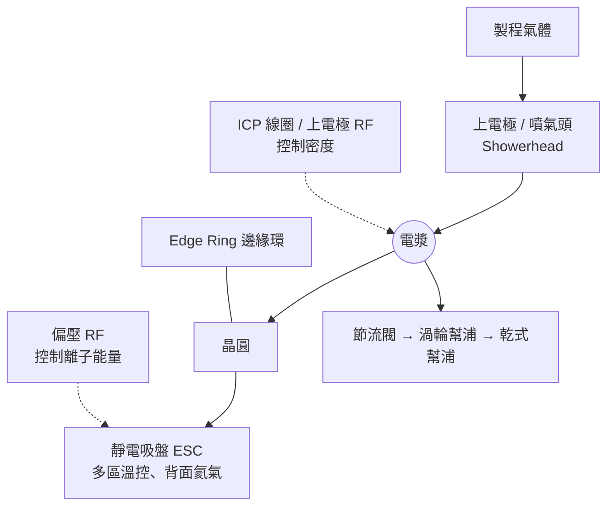

# 09. 設備深入（一）：蝕刻機台

> **一句話**：蝕刻是晶圓廠機台數量多、製程最複雜的模組之一。設備工程師要懂**電漿怎麼產生、腔體零件怎麼磨耗、參數改變會怎麼影響蝕刻結果**，才能在警報與良率異常時快速判斷是機台、零件還是製程的問題。

## 學習目標

- 理解電漿蝕刻的基本機制：離子、自由基、鞘層與偏壓
- 分辨 CCP、ICP 架構與多頻 RF 的用途
- 熟悉腔體關鍵零件：上電極、ESC、Edge Ring、Liner 與其磨耗影響
- 掌握製程參數對蝕刻速率、選擇比、均勻度與輪廓的影響
- 了解腔體保養、Seasoning 與常見警報的排查
- 認識高深寬比蝕刻、低溫蝕刻、ALE 等先進技術

> 前置知識：[第 07 章](07-semiconductor-process-equipment.md)的蝕刻概念與真空、RF 子系統。

---

## 1. 電漿蝕刻機制 🟢

電漿中有三種主角：

| 粒子 | 作用 | 特性 |
|---|---|---|
| **離子** | 被電場加速垂直撞擊晶圓 | 提供**方向性**（非等向），也會造成物理損傷 |
| **自由基（中性活性粒子）** | 與表面化學反應生成揮發性產物 | 提供**化學蝕刻**與選擇比，本身等向 |
| **電子** | 撞擊氣體分子維持電漿 | 決定電漿密度 |

- **鞘層（Sheath）**：電漿與晶圓之間的電場區，離子在此被加速，**偏壓功率決定離子能量**
- **離子輔助蝕刻**：離子轟擊打斷表面鍵結，自由基再反應帶走，兩者協同時蝕刻速率遠大於各自單獨
- **側壁鈍化（Passivation）**：反應副產物或含碳氟聚合物沉積在側壁，保護側壁不被橫向蝕刻，是做出垂直輪廓的關鍵

## 2. 機台架構 🟡

| 架構 | 原理 | 特性 | 常見用途 |
|---|---|---|---|
| **CCP（電容耦合）** | 上下兩片平行電極 | 離子能量高、均勻 | **介電層蝕刻**（氧化矽、氮化矽） |
| **ICP / TCP（感應耦合）** | 線圈產生磁場感應電漿，晶圓台另加偏壓 | **電漿密度與離子能量可分開控制** | **導體蝕刻**（矽、多晶矽、金屬） |

**多頻 RF**：
- **高頻**（如 27、60MHz 等）：主要提高**電漿密度**
- **低頻**（如 2MHz 或更低）：主要提高**離子能量**
- **RF 脈衝（Pulsing）**：開關 RF 或改變功率，降低充電損傷、改善選擇比與輪廓控制

## 3. 腔體關鍵零件與磨耗 🟡

| 零件 | 功能 | 磨耗或異常時的影響 |
|---|---|---|
| **上電極 / Showerhead** | 均勻分配氣體、作為電極 | 孔洞磨耗或堵塞 → 均勻度改變、微粒 |
| **ESC（靜電吸盤）** | 吸住晶圓、控溫 | 表面磨耗 → 吸附力下降、**氦氣漏率上升**、溫度不均 |
| **Edge Ring / Focus Ring** | 延伸電漿邊界、控制晶圓邊緣電場 | **被蝕刻變薄 → 邊緣鞘層改變 → 邊緣蝕刻速率與角度偏移（Edge Tilt）** |
| **Liner / 腔壁** | 保護腔體、影響電漿化學 | 沉積物累積 → 剝落成微粒、蝕刻速率飄移 |
| **石英 / 陶瓷窗（ICP）** | 讓 RF 能量通過 | 沉積或磨耗影響耦合效率 |
| **O-ring** | 真空密封 | 老化 → 漏氣、微粒 |

> 零件壽命常以 **RF 小時數**追蹤。Edge Ring 磨耗是邊緣良率問題的經典原因，新一代機台有可在真空中自動更換或調整 Edge Ring 高度的設計。

## 4. 製程參數與結果 🟡

### 4.1 關鍵指標

| 指標 | 說明 |
|---|---|
| **蝕刻速率（ER）** | 每分鐘蝕刻厚度 |
| **均勻度** | 晶圓內各點差異（常以 % 表示） |
| **選擇比** | 目標材料 ÷ 遮罩或下層材料的蝕刻速率 |
| **CD Bias** | 蝕刻後與蝕刻前線寬的差 |
| **輪廓（Profile）** | 側壁角度：垂直、斜角（Taper）、弓形（Bowing）、底部缺口（Notching） |
| **Microloading / ARDE** | 圖形密度或深寬比不同造成的蝕刻速率差異 |
| **殘留 / 損傷** | 聚合物殘留、電漿損傷 |

### 4.2 參數影響（一般趨勢，實際依製程而異）

| 參數 ↑ | 常見影響 |
|---|---|
| **偏壓功率** | 離子能量 ↑ → 非等向性 ↑、ER ↑、**選擇比通常 ↓**、損傷 ↑ |
| **源功率** | 電漿密度 ↑ → ER ↑、自由基 ↑ |
| **壓力** | 碰撞增加 → 方向性 ↓、自由基比例 ↑、可能更等向 |
| **聚合性氣體**（如 C₄F₈） | 側壁鈍化 ↑、選擇比 ↑，過多會造成蝕刻停止或殘留 |
| **O₂ 添加** | 清除聚合物，ER ↑ 但對光阻的選擇比 ↓ |
| **晶圓溫度** | 影響聚合物沉積與化學反應，**溫度分區**可調整中心 / 邊緣均勻度 |

**常用氣體化學**：
- 氧化矽 / 氮化矽：**碳氟氣體**（如 CF₄、CHF₃、C₄F₈）
- 矽 / 多晶矽：**Cl₂、HBr**
- 光阻去除（Ashing）：**O₂** 電漿

### 4.3 終點偵測

- **OES（光學發射光譜）**：監測特定波長（反應產物或反應物）強度變化，判斷穿透到下層
- **干涉法**：量測薄膜厚度變化
- 開口率很低（如接觸窗）時訊號微弱，常需搭配固定時間的**過蝕刻（Over-etch）**

## 5. 保養與腔體狀態管理 🟡

- **WAC（Waferless Auto Clean）**：每片或每批之間不放晶圓、用電漿清潔腔壁，維持腔體狀態一致
- **Seasoning**：PM 或濕式清潔後，先跑假片讓腔壁覆蓋穩定的沉積層，**避免前幾片蝕刻結果偏移（First Wafer Effect）**
- **濕式清潔（Wet Clean PM）**：開腔、清潔或更換零件，之後要 Pump Down、測漏、Seasoning、Qualification
- **監控**：ER、均勻度、微粒監控片；FDC 監控 RF 匹配器位置、反射功率、壓力、節流閥開度、氦氣流量

## 6. 常見警報與異常 🔴

| 現象 | 可能原因 | 排查方向 |
|---|---|---|
| **反射功率高 / 匹配器來回找點（Hunting）** | 腔體狀態變化、匹配器故障、RF 線材接觸 | 看匹配器電容位置趨勢、檢查 RF 連接、比較 PM 前後 |
| **Arcing（電弧）** | 腔體零件破損、沉積物剝落、ESC 問題 | 檢查零件表面燒痕、微粒來源 |
| **氦氣背壓 / 漏率高** | ESC 磨耗、晶圓翹曲、晶圓背面微粒 | 換晶圓測試、檢查 ESC 表面、背面微粒 |
| **脫附失敗（Dechuck Fail）/ 晶圓跳片** | ESC 殘留電荷 | 調整脫附程序、檢查 ESC 與 Lift Pin |
| **壓力不穩** | 節流閥、幫浦、MFC、漏氣 | 看節流閥開度趨勢、Rate-of-Rise |
| **ER 慢慢飄移** | 零件磨耗、腔壁狀態、MFC 飄移 | 對照 RF 小時數、零件壽命、MFC 校正 |
| **邊緣均勻度變差** | **Edge Ring 磨耗**、邊緣溫度區 | 量測邊緣輪廓、檢查 Edge Ring 厚度 |
| **微粒增加** | Liner 沉積剝落、O-ring、Lift Pin 摩擦 | 微粒分布圖（Particle Map）判斷來源位置 |
| **終點偵測失敗** | OES 視窗被污染、訊號弱 | 清潔或更換視窗、檢查光纖 |

> 判讀 **Particle Map** 的經驗：環狀分布常跟 Edge Ring 或邊緣有關、固定位置常跟 Lift Pin 或特定零件有關、隨機分布則可能是腔壁剝落或氣體路徑。

## 7. 先進蝕刻技術 🔴

| 技術 | 說明 | 應用 |
|---|---|---|
| **高深寬比蝕刻（HAR）** | 深寬比數十比一以上的孔洞或溝槽 | **3D NAND 通道孔**、DRAM 電容 |
| **低溫蝕刻（Cryogenic Etch）** | 晶圓在極低溫下蝕刻，提高速率與輪廓控制 | 3D NAND 等高深寬比應用 |
| **ALE（原子層蝕刻）** | 表面改質 → 去除，自限性逐層蝕刻 | 先進邏輯、超薄層 |
| **選擇性蝕刻** | 在不同材料間極高選擇比 | **GAA 電晶體**中選擇性去除 SiGe 釋放奈米片 |
| **Bosch 製程** | 蝕刻與鈍化交替循環 | TSV、MEMS 深矽蝕刻（見[第 12 章](12-advanced-packaging-equipment.md)） |

---

## 動手練習

1. **參數推理**：某製程 CD 變大、側壁變斜，列出 3 個可能的參數或零件原因，並說明如何驗證。
2. **Particle Map 判讀**：自己畫 4 種微粒分布（環狀、單點聚集、隨機、扇形），寫出對應的可能來源。
3. **讀論文或技術文章**：搜尋 "atomic layer etching review" 或 "high aspect ratio etch challenges"，整理 3 個主要挑戰。
4. **設計 FDC 監控**：列出 5 個你會監控的蝕刻機台參數，說明每個參數異常可能代表什麼。

## 面試常問

> 先試著自己回答，再對照參考解答。

### Q1. CCP 和 ICP 的差別？

- **CCP**：平行板電極，電漿密度與離子能量耦合在一起，離子能量高，適合需要強物理轟擊的**介電層蝕刻**
- **ICP**：線圈感應產生高密度電漿，晶圓台另外加偏壓，**密度與離子能量可獨立控制**，適合要求高選擇比與輪廓控制的**導體蝕刻**

### Q2. 為什麼 Edge Ring 磨耗會影響良率？

Edge Ring 讓晶圓邊緣的電場與鞘層延續中間區域。Edge Ring 變薄後，**邊緣鞘層彎曲**，離子以傾斜角度撞擊晶圓邊緣，造成**邊緣蝕刻角度傾斜（Tilt）、CD 與蝕刻速率改變**，邊緣晶粒良率下降。所以要依 RF 小時數更換，或使用可調整高度的機構補償。

### Q3. 蝕刻速率逐漸下降，你會怎麼查？

1. 確認是**突然**還是**逐漸**：逐漸常與零件磨耗或腔壁累積有關
2. 對照**零件 RF 小時數**、上次 PM 時間
3. 檢查 FDC：RF 功率、反射功率、匹配器位置、壓力、節流閥開度、氣體流量、溫度
4. 檢查 MFC 與壓力計是否需要校正
5. 若是 PM 後發生，檢查零件安裝、Seasoning 是否足夠
6. 必要時與製程工程師討論調整配方或安排 PM

### Q4. 什麼是 First Wafer Effect？如何避免？

機台閒置或清潔後，腔壁狀態（溫度、沉積層）與連續生產時不同，造成**前幾片晶圓蝕刻結果偏移**。對策：生產前跑**假片 Seasoning**、每片之間做 **WAC** 維持腔壁一致、閒置時保持溫度、設定閒置時間過長時自動執行調理程序。

### Q5. 選擇比如何提高？

- 降低偏壓（離子能量），減少物理濺射
- 調整氣體化學，增加聚合性氣體保護遮罩或下層
- 調整溫度控制聚合物沉積
- 使用 RF 脈衝
- 代價可能是蝕刻速率下降或輪廓改變，需整體權衡

### Q6. ESC 氦氣漏率升高代表什麼？

氦氣在晶圓背面提供熱傳導，漏率升高表示晶圓與 ESC 之間密封變差。原因可能是 **ESC 表面磨耗或損傷**、**晶圓翹曲**、**晶圓背面有微粒或沉積**、吸附電壓不足。影響是晶圓溫度控制變差，進而影響蝕刻結果。排查時先用標準晶圓測試，再檢查 ESC 表面與吸附參數。

## 常見誤解

- **「功率加大就蝕刻得更好」**：功率影響速率、選擇比、損傷與輪廓，必須整體權衡。
- **「PM 後一定比較好」**：PM 後腔體狀態改變，需要 Seasoning 與 Qualification，否則可能出現首片效應。
- **「蝕刻問題都是製程工程師的事」**：大量製程飄移源自零件磨耗與機台狀態，設備與製程工程師要密切合作。

## 本章回顧

- 機制：離子（方向性）+ 自由基（化學）+ 側壁鈍化
- 架構：CCP（介電）、ICP（導體）；高頻控密度、低頻控離子能量
- 零件：Showerhead、ESC、**Edge Ring**、Liner，以 RF 小時數管理
- 參數：偏壓、源功率、壓力、氣體、溫度對 ER、選擇比、輪廓的影響
- 先進：高深寬比、低溫蝕刻、ALE、GAA 選擇性蝕刻
