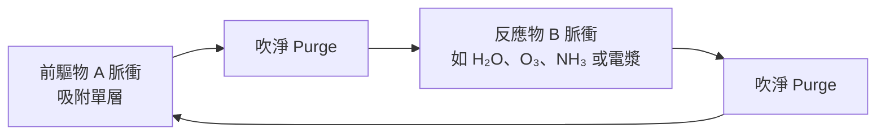

# 10. 設備深入（二）：薄膜沉積機台

> **一句話**：薄膜模組包含 CVD、PVD、ALD、磊晶、電鍍與爐管，種類最多。設備工程師的共通功課是**溫度、前驅物輸送、電漿、真空與腔體清潔**；把這些子系統顧好，膜厚、均勻度、應力與微粒才會穩定。

## 學習目標

- 分辨 CVD、PVD、ALD、磊晶、電鍍、爐管的原理與機台特性
- 了解前驅物輸送系統（Bubbler、Vaporizer、加熱管路）的重點
- 熟悉薄膜品質指標：膜厚、均勻度、折射率、應力、階梯覆蓋、電阻
- 掌握遠端電漿清潔、PVD 靶材管理、ALD 閥門壽命等保養重點
- 能排查膜厚飄移、微粒、均勻度、應力異常等常見問題

> 前置知識：[第 07 章](07-semiconductor-process-equipment.md)的薄膜概念與真空、氣體子系統。

---

## 1. 薄膜機台總覽 🟢

| 類型 | 原理 | 典型薄膜 | 機台特性 |
|---|---|---|---|
| **PECVD** | 電漿輔助化學反應，較低溫 | SiO₂、SiN、SiON、低介電材料 | 單片或多站式腔體、RF、加熱台 |
| **HDP-CVD / Flowable CVD** | 高密度電漿邊沉積邊濺射 / 可流動材料 | **填溝（Gap Fill）**，如 STI | 填縫能力是關鍵 |
| **LPCVD（爐管）** | 低壓高溫 | 多晶矽、SiN | 批次處理上百片 |
| **金屬 CVD** | 如 WF₆ 還原沉積鎢 | W 接觸插塞 | 成核層 + 主沉積 |
| **PVD（濺鍍）** | 離子撞擊靶材，原子沉積 | Ti、TiN、Ta、TaN、Cu Seed、Al | 磁控濺鍍、靶材、高真空 |
| **ALD** | 前驅物輪流脈衝、自限性反應 | High-k（如 HfO₂）、Al₂O₃、TiN、間隔層 | **快速閥門**、精準溫控 |
| **磊晶（Epi）** | 在單晶上長出單晶 | Si、SiGe、Si:P | 高溫、預清潔、選擇性成長 |
| **ECP（電鍍）** | 電化學沉積 | **Cu 導線** | 鍍液、陽極、添加劑管理 |
| **熱氧化 / 退火爐管** | 高溫氧化或熱處理 | 閘極氧化、退火 | 溫度均勻、批次 |

## 2. 各類機台重點 🟡

### 2.1 CVD

- **反應受控 vs 擴散受控**：低溫時速率由表面反應決定（對溫度敏感），高溫時由氣體擴散決定（對流場敏感）
- **噴氣頭（Showerhead）與晶圓間距**（Spacing）影響均勻度
- **加熱台（Heater / Pedestal）**：常用 AlN 陶瓷，多區加熱；溫度偏差直接影響膜厚與膜質
- **腔體清潔**：用 **RPS**（遠端電漿源）分解 NF₃ 產生氟自由基清除腔壁沉積，清潔不足 → 微粒；過度 → 零件腐蝕
- **薄膜應力**：PECVD 可透過 RF 頻率與功率調整壓應力 / 張應力

### 2.2 PVD

| 重點 | 說明 |
|---|---|
| **磁控濺鍍** | 靶材背後的磁鐵把電子束縛在靶表面附近，提高效率；磁鐵旋轉讓靶材均勻消耗 |
| **DC / RF / 脈衝 DC** | 金屬用 DC，絕緣靶材用 RF，反應性濺鍍常用脈衝 DC 減少電弧 |
| **離子化 PVD** | 讓濺射原子離子化並用偏壓引導，改善孔洞底部覆蓋 |
| **靶材壽命** | 以累計能量（kWh）管理；靶材快用盡時膜厚與均勻度改變，**燒穿會造成嚴重污染** |
| **Shield / Kit** | 擋板收集多餘沉積，定期更換；沉積過厚會剝落成微粒 |
| **新靶燒入（Burn-in）** | 新靶材先濺射一段時間去除表面氧化與污染 |
| **Degas / Preclean** | 沉積前先除氣、用電漿去除原生氧化層，確保接觸電阻 |

### 2.3 ALD

- **GPC**（每循環成長量）通常只有約 0.1nm 等級，厚度由**循環次數**精準控制
- **ALD 溫度視窗**：溫度太低會凝結或反應不完全，太高前驅物會自行分解（變成 CVD 行為）
- **熱 ALD vs 電漿 ALD（PEALD）**：電漿可降低溫度、改變膜質
- **快速 ALD 閥門**：每片晶圓動作數萬次，**閥門壽命**是重要保養項目
- **前驅物瓶（Ampoule）**：需加熱維持蒸氣壓，液位下降與溫度變化都會影響劑量

### 2.4 磊晶

- 高溫（數百度到上千度）在單晶表面長出晶格整齊的薄膜
- **預清潔**去除原生氧化層非常關鍵，否則產生缺陷
- **選擇性磊晶**：只在矽表面成長，介電層上不長（常加入 HCl 抑制）
- 應用：源 / 汲極、SiGe 應變層、GAA 的 Si / SiGe 疊層

### 2.5 電鍍（ECP）

- 銅**大馬士革製程**：蝕刻溝槽 → PVD 阻障層與 Cu Seed → **電鍍填銅** → CMP
- 鍍液添加劑：**加速劑、抑制劑、平整劑**，讓溝槽**由下往上填滿**（Bottom-up Fill）避免空洞
- 管理重點：鍍液成分分析與補充、陽極、晶圓接觸、鍍後退火

### 2.6 前驅物與氣體輸送

| 元件 | 重點 |
|---|---|
| **Bubbler** | 載氣通過液態前驅物帶出蒸氣，劑量受溫度與液位影響 |
| **Vaporizer / 液體 MFC** | 液體計量後汽化，避免溫度不足造成凝結或殘留 |
| **加熱管路（Heat Trace）** | 防止前驅物在管路中凝結；溫度失效是堵塞常見原因 |
| **尾氣與冷阱** | 反應副產物（粉末）會堵塞排氣與幫浦，需定期清理 |
| **Scrubber** | 處理有毒或可燃尾氣 |

## 3. 薄膜品質指標 🟡

| 指標 | 量測方式 | 意義 |
|---|---|---|
| **膜厚與均勻度**（晶圓內 / 晶圓間） | 橢圓偏光儀、反射光譜 | 最基本的監控 |
| **折射率（RI）** | 橢圓偏光儀 | 反映膜的組成與密度 |
| **應力** | 量測鍍膜前後晶圓彎曲度 | 太大會造成翹曲、裂痕、剝離 |
| **階梯覆蓋 / 共形性** | 截面 SEM / TEM | 側壁與底部厚度比例 |
| **填溝能力** | 截面 | 是否有空洞（Void）或接縫（Seam） |
| **片電阻（Rs）** | 四點探針 | 金屬膜厚與品質 |
| **微粒** | 微粒量測機台 | 腔體清潔狀況 |
| **組成 / 雜質** | XPS、SIMS 等 | 研發與異常分析 |

## 4. 常見異常與排查 🔴

| 現象 | 可能原因 | 排查方向 |
|---|---|---|
| **膜厚逐漸飄移** | 加熱台溫度、MFC、前驅物瓶溫度或液位、靶材消耗 | 對照溫度與流量趨勢、前驅物使用量、靶材 kWh |
| **均勻度變差** | 噴氣頭孔洞堵塞、Spacing 改變、加熱分區失效、磁鐵旋轉異常（PVD） | 膜厚分布圖形（中心厚 / 邊緣厚 / 單側）判斷方向 |
| **微粒增加** | 清潔週期不足、Shield 沉積過厚、管路粉末回流 | 微粒分布圖、清潔紀錄、排氣壓力 |
| **應力改變** | RF 功率或頻率、溫度、氣體比例 | 對照配方與 FDC 數據 |
| **RPS 清潔失敗** | RPS 點火異常、NF₃ 供應、腔體過髒 | 清潔終點訊號、RPS 狀態 |
| **PVD 電弧（Arcing）** | 靶材表面結瘤、反應性濺鍍毒化 | 電弧計數、檢查靶材表面 |
| **ALD 膜厚異常** | 閥門故障、前驅物劑量不足、Purge 不足造成 CVD 行為 | 閥門動作次數、壓力脈衝波形 |
| **排氣堵塞** | 副產物粉末累積 | 前級壓力上升、幫浦電流，安排清管 |
| **金屬膜電阻上升** | 預清潔不足、真空漏氣造成氧化 | 測漏、殘氣分析（RGA） |

> **看膜厚分布圖找原因**：中心厚邊緣薄常與氣流或 Spacing 有關；單側偏厚常與加熱分區、晶圓放置偏移或腔體不對稱有關；環狀變化常與加熱台或磁鐵有關。

## 5. 先進製程趨勢 🔴

- **GAA 電晶體**：需要極精準的 **ALD**（閘極介電、功函數金屬）與 **Si / SiGe 磊晶疊層**
- **導線材料**：銅在極細線寬下電阻上升，研究與導入 **鈷、釕、鉬**等替代材料
- **低介電常數（Low-k）材料**：降低導線間電容，但機械強度弱，與 CMP、封裝都有關
- **區域選擇性沉積（ASD）**：只在特定材料表面沉積，減少微影與蝕刻步驟
- **3D NAND**：大量 SiO₂ / SiN 交替堆疊，對膜厚、應力、均勻度要求極高

---

## 動手練習

1. **ALD 計算**：GPC = 0.1nm / 循環、每循環 2 秒，長 3nm 需要幾個循環與多少時間？若每片晶圓 4 支閥門各動作一次 / 循環，一天處理 500 片，每支閥門一天動作幾次？
2. **膜厚分布推理**：分別畫出「中心厚」「邊緣厚」「左右不對稱」三種分布，寫出各自可能的機台原因。
3. **PVD 靶材管理**：假設靶材壽命 1500kWh、每片晶圓消耗 0.05kWh，計算可處理片數，並說明為什麼要預留安全餘量。
4. **讀資料**：搜尋 "area selective deposition" 或 "ALD precursor delivery"，整理 3 個重點。

## 面試常問

> 先試著自己回答，再對照參考解答。

### Q1. ALD 為什麼可以做到極佳的共形性？

ALD 的每個半反應都是**自限性**的：前驅物只會吸附到表面的反應位置，佔滿後就不再增加，多餘的被吹淨。因此不論表面是平面、側壁或深孔底部，只要前驅物有足夠時間擴散進去，每循環都只長一層，達到**均勻且共形**的覆蓋。

### Q2. 什麼是 ALD 溫度視窗？

在一定溫度範圍內，GPC 幾乎不隨溫度改變，這是理想的 ALD 行為區間。溫度**太低**：前驅物凝結或反應不完全；溫度**太高**：前驅物熱分解，變成 CVD 式連續沉積，失去自限性，或已吸附的分子脫附。

### Q3. PECVD 膜厚逐漸變薄，你會怎麼查？

1. 確認趨勢與 PM / 清潔週期的關係
2. 檢查 FDC：RF 功率與反射功率、加熱台溫度、壓力、各氣體 MFC 流量
3. 檢查噴氣頭是否堵塞、Spacing 是否改變
4. 確認 RPS 清潔是否正常（腔壁狀態影響）
5. MFC 與溫度量測元件校正
6. 與製程工程師確認是否需調整時間或安排 PM

### Q4. PVD 靶材快用完時有什麼風險？

- 靶材侵蝕溝槽加深，**膜厚與均勻度改變**
- 若**燒穿**到背板，背板材料（如銅）被濺射到晶圓，造成嚴重**污染**與報廢，還可能損壞腔體
- 因此要嚴格以 kWh 管理壽命並預留餘量，更換後需燒入與驗證

### Q5. 為什麼銅導線要用電鍍而不用 PVD 直接填滿？

PVD 是直線性沉積，在窄而深的溝槽中會先在開口處堆積，**形成懸垂（Overhang）並封口留下空洞**。電鍍透過添加劑控制，讓溝槽底部成長較快，實現**由下往上填滿**，且速度快、成本低。PVD 只用來沉積很薄的阻障層與 Seed 層。

### Q6. 薄膜應力太大會造成什麼問題？

晶圓翹曲影響微影對焦與 Overlay、機械手臂與 ESC 取放異常、薄膜**裂痕或剝離**、元件特性改變。先進製程與 3D NAND 多層堆疊時，應力累積更明顯，需要用製程參數（RF、溫度、氣體比例）調整應力，並監控晶圓彎曲度。

## 常見誤解

- **「薄膜只要膜厚對就好」**：折射率、應力、共形性、雜質、微粒同樣重要。
- **「清潔越多越乾淨越好」**：過度清潔會腐蝕零件、改變腔壁狀態，需找到平衡。
- **「ALD 只是慢一點的 CVD」**：ALD 的自限性機制提供 CVD 做不到的原子級控制與共形性。

## 本章回顧

- 機台家族：PECVD、HDP / Flowable CVD、LPCVD、金屬 CVD、PVD、ALD、磊晶、ECP、爐管
- 子系統重點：加熱台、噴氣頭與 Spacing、RPS 清潔、前驅物輸送與加熱管路、靶材與 Shield
- 品質指標：膜厚與均勻度、RI、應力、共形性、填溝、Rs、微粒
- 看膜厚分布圖形推論機台原因；ALD 注意溫度視窗與閥門壽命
- 趨勢：GAA 的 ALD 與磊晶、新導線材料、選擇性沉積
