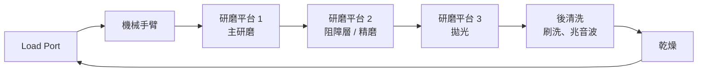

# 11. 設備深入（三）：CMP 化學機械研磨機台

> **一句話**：CMP 是「化學 + 機械」的平衡藝術。研磨頭、研磨墊、鑽石碟、研磨液、後清洗，任何一個耗材狀態改變都會讓移除速率、均勻度或缺陷改變。設備工程師的核心是**耗材壽命管理與研磨輪廓控制**。

## 學習目標

- 理解 CMP 機台架構：研磨頭、平台、研磨墊、鑽石碟、研磨液、後清洗
- 用 Preston 方程式理解移除速率的影響因素
- 分辨氧化物、STI、鎢、銅等 CMP 製程的特性
- 掌握碟化、侵蝕、刮傷、腐蝕等缺陷的成因
- 熟悉耗材管理、終點偵測與 APC
- 了解混合鍵合對 CMP 的新要求

> 前置知識：[第 07 章](07-semiconductor-process-equipment.md)的 CMP 概念。

---

## 1. 機台架構 🟢

| 組件 | 功能 | 重點 |
|---|---|---|
| **研磨頭（Carrier / Head）** | 吸住晶圓背面並施壓 | **多區薄膜**（Membrane）可分區調壓；**Retaining Ring** 防止晶圓滑出並影響邊緣輪廓 |
| **平台（Platen）** | 帶動研磨墊旋轉 | 轉速、溫度 |
| **研磨墊（Pad）** | 傳遞壓力、承載研磨液 | 多孔聚氨酯材料，表面有溝槽；硬墊平坦化好、軟墊缺陷少 |
| **鑽石碟（Conditioner）** | 修整研磨墊表面，維持粗糙度 | 沒有修整時研磨墊會**釉化（Glazing）**，移除速率下降 |
| **研磨液（Slurry）** | 化學反應 + 研磨顆粒 | 顆粒種類（二氧化矽、氧化鈰、氧化鋁）、pH、氧化劑 |
| **終點偵測** | 判斷研磨完成 | 光學、渦電流（金屬）、馬達扭矩 |
| **後清洗** | 去除研磨液顆粒與金屬污染 | PVA 刷洗、兆音波、化學液、乾燥 |

## 2. 移除速率：Preston 方程式 🟡

`RR = Kp × P × V`

- **RR**：移除速率
- **P**：下壓力
- **V**：晶圓與研磨墊的相對速度
- **Kp**：Preston 係數，包含研磨液化學、研磨墊狀態、溫度等因素

實務意義：
- 壓力與轉速是主要調整手段，但**提高壓力也會增加缺陷與碟化**
- **Kp 會隨耗材狀態改變**：研磨墊釉化、鑽石碟磨耗、研磨液變化都讓 Kp 下降 → 移除速率飄移
- 研磨墊溫度上升會加快化學反應，影響速率

## 3. 製程類型 🟡

| 製程 | 目的 | 研磨液 / 重點 |
|---|---|---|
| **ILD / 氧化物 CMP** | 介電層平坦化 | 二氧化矽顆粒、高 pH |
| **STI CMP** | 淺溝槽隔離 | **氧化鈰研磨液**，對氮化矽高選擇比，停在氮化矽上 |
| **W CMP** | 去除多餘鎢 | 酸性、含氧化劑 |
| **Cu CMP** | 大馬士革製程 | 多階段：**銅主研磨 → 阻障層研磨 → 拋光**，含氧化劑與腐蝕抑制劑 |
| **Poly CMP** | 多晶矽 | 閘極相關製程 |
| **混合鍵合前 CMP** | 鍵合表面 | 對表面粗糙度與銅凹陷量要求極嚴（見[第 12 章](12-advanced-packaging-equipment.md)） |

## 4. 輪廓控制 🟡

- **晶圓內均勻度（WIWNU）**：用研磨頭**多區壓力**調整中心、中間、邊緣的移除量
- **晶圓間均勻度（WTWNU）**：耗材狀態飄移造成批次間差異
- **邊緣輪廓**：Retaining Ring 磨耗、壓力、研磨墊回彈會造成邊緣**過磨（Edge Fast）或研磨不足（Edge Slow）**
- **APC / R2R**：依前一批或研磨前的膜厚量測，自動調整研磨時間或各區壓力（見[第 08 章](08-equipment-engineering-practice.md)）
- **原位量測（In-situ）**：研磨中即時量測厚度，達到目標即停止並分區調壓

## 5. 缺陷類型與成因 🔴

| 缺陷 | 說明 | 常見原因 |
|---|---|---|
| **碟化（Dishing）** | 寬金屬線中間凹陷 | 過度研磨、研磨墊太軟、選擇比 |
| **侵蝕（Erosion）** | 密集圖形區整體被磨低 | 圖形密度、過度研磨 |
| **刮傷（Scratch / Micro-scratch）** | 表面刮痕 | **研磨液顆粒團聚**、鑽石碟顆粒脫落、碎屑 |
| **殘留** | 研磨液顆粒、有機物殘留 | 後清洗不足、刷子老化 |
| **腐蝕** | 銅表面腐蝕 | 研磨後**等待清洗時間過長（Q-time）**、化學配比、電化學（Galvanic）腐蝕 |
| **剝離（Delamination）** | 低介電材料剝離 | 剪應力太大、Low-k 機械強度弱 |
| **研磨不足 / 殘留金屬** | 金屬短路 | 終點偵測失準、均勻度差 |

> **刮傷的經典排查**：依刮痕形態判斷——長弧形常與研磨墊上的硬顆粒有關，短而密集常與研磨液顆粒團聚有關；同時檢查研磨液過濾器、輸送管路、鑽石碟狀態。

## 6. 耗材與研磨液管理 🟡

| 耗材 | 壽命指標 | 磨耗影響 |
|---|---|---|
| **研磨墊** | 研磨片數 / 時數、溝槽深度 | 溝槽變淺 → 研磨液分布變差、速率與均勻度改變 |
| **鑽石碟** | 使用時數 | 修整能力下降 → 研磨墊釉化、速率下降；鑽石脫落 → 刮傷 |
| **Retaining Ring** | 厚度 | 變薄 → 邊緣輪廓改變、晶圓滑出風險 |
| **研磨頭薄膜** | 使用次數 | 破損 → 壓力異常、晶圓吸附失敗 |
| **後清洗刷子** | 使用時數 | 老化 → 殘留增加、刷子本身污染 |

**研磨液系統**：
- 研磨液會**沉降與團聚**，需持續循環攪拌，並管理**保存期限**
- 管路中的**過濾器**擋住大顆粒，壓差上升時需更換
- 研磨液與氧化劑（如 H₂O₂）常在使用點附近混合，**混合比例與流量**直接影響移除速率
- 量測項目：顆粒大小分布（尤其大顆粒數量）、pH、比重

## 7. 常見異常與排查 🔴

| 現象 | 可能原因 | 排查方向 |
|---|---|---|
| **移除速率下降** | 研磨墊釉化、鑽石碟磨耗、研磨液流量或濃度、氧化劑比例 | 耗材壽命、修整參數、研磨液流量與混合比例 |
| **邊緣輪廓改變** | Retaining Ring 磨耗、邊緣區壓力 | 量 Ring 厚度、壓力校正 |
| **刮傷增加** | 研磨液團聚、過濾器、鑽石碟顆粒脫落、異物 | 缺陷形態、研磨液大顆粒量測、更換過濾器 |
| **晶圓滑出（Slip-out）** | Retaining Ring 磨耗、壓力或轉速異常、研磨墊表面狀態 | Ring 厚度、真空吸附、感測器 |
| **終點偵測失誤** | 光學視窗污染、研磨墊視窗磨耗、膜層結構變化 | 終點訊號波形、視窗狀態 |
| **銅腐蝕** | Q-time 超時、清洗化學配比 | 檢查機台內等待時間、清洗液濃度 |
| **殘留顆粒多** | 刷子老化、清洗液、兆音波功率 | 刷子使用時數、清洗參數 |

## 8. 混合鍵合帶來的新要求 🔴

**混合鍵合**（Hybrid Bonding）直接把兩片晶圓或晶粒的銅與介電層對接，CMP 成為良率關鍵：
- 表面需要**奈米級平坦度與極低粗糙度**
- 銅墊相對介電層的**凹陷量**（Recess）要精準控制在奈米範圍
- 對**微粒與殘留**幾乎零容忍，任何顆粒都會造成鍵合空洞
- 因此先進封裝產線的 CMP 製程與設備需求大增

---

## 動手練習

1. **Preston 計算**：壓力從 2psi 增加到 3psi、轉速不變，理論上移除速率變化多少？實際上可能有哪些副作用？
2. **耗材排程**：假設研磨墊壽命 1000 片、鑽石碟 3000 片、Retaining Ring 2000 片，設計一個 PM 排程讓停機次數最少。
3. **缺陷推理**：Cu CMP 後缺陷檢測發現大量腐蝕點，列出 5 個可能原因與驗證方式。
4. **讀資料**：搜尋 "hybrid bonding CMP requirements" 或 "CMP slurry large particle count"，整理重點。

## 面試常問

> 先試著自己回答，再對照參考解答。

### Q1. 說明 CMP 的原理與主要組件

CMP 結合**化學反應**（研磨液軟化或改質表面）與**機械研磨**（顆粒與研磨墊移除），把晶圓表面磨平。主要組件：研磨頭（多區壓力、Retaining Ring）、平台與研磨墊、鑽石碟修整器、研磨液輸送、終點偵測、後清洗與乾燥。

### Q2. 移除速率突然下降，你會怎麼查？

1. 檢查**研磨液**：流量、混合比例、氧化劑濃度、批號是否更換
2. 檢查**鑽石碟**：是否正常下壓與掃描、使用時數
3. 檢查**研磨墊**：是否釉化、使用片數、溫度
4. 檢查**研磨頭壓力**與平台轉速是否正常
5. 確認是否剛 PM 或更換耗材，必要時重跑監控片

### Q3. 碟化與侵蝕的差別？

- **碟化（Dishing）**：發生在**單一寬金屬**，金屬中間比周圍介電層低，因為軟金屬被研磨墊壓入後持續移除
- **侵蝕（Erosion）**：發生在**密集細線區域**，整個區域（金屬與介電層）比周圍低，因為密集區承受的研磨較多

兩者都造成表面不平與電阻上升，可透過選擇比、研磨墊硬度、過研磨時間、設計端的**密度規則**（Dummy Fill）改善。

### Q4. 為什麼需要鑽石碟修整？

研磨過程中研磨墊表面的孔洞會被研磨液與碎屑填滿、表面變光滑（**釉化**），導致承載研磨液能力下降、移除速率降低且不穩定。鑽石碟持續刮開表面，恢復粗糙度與孔隙，讓移除速率穩定。

### Q5. Cu CMP 後為什麼要控制 Q-time？

研磨後銅表面殘留化學液並暴露在環境中，等待時間太久會**氧化與腐蝕**，若研磨液殘留乾掉也更難清除。因此研磨後要在規定時間內完成清洗與乾燥，機台內部也要避免晶圓卡在研磨與清洗之間太久。

### Q6. 刮傷增加，你會從哪些方向找原因？

1. **研磨液**：大顆粒數量、團聚、保存期限、過濾器壓差與更換時間
2. **鑽石碟**：鑽石脫落、碟片損傷
3. **研磨墊**：異物、破損、使用壽命
4. **研磨頭 / Retaining Ring**：碎屑、Ring 材料剝落
5. **後清洗**：刷子夾帶顆粒
6. 依刮痕形態與分布縮小範圍，並對照更換耗材的時間點

## 常見誤解

- **「CMP 只是把東西磨平」**：CMP 牽涉化學反應、選擇比、終點控制與缺陷管理，是高度精密的製程。
- **「壓力加大就能提高產能」**：壓力上升會增加刮傷、碟化與低介電材料剝離風險。
- **「耗材用到壽命上限才換最省錢」**：耗材末期的飄移與缺陷可能造成更大的良率損失，需依數據決定更換點。

## 本章回顧

- 架構：研磨頭（多區壓力、Retaining Ring）、研磨墊、鑽石碟、研磨液、終點偵測、後清洗
- Preston：RR = Kp × P × V，Kp 隨耗材狀態飄移
- 製程：氧化物、STI（氧化鈰）、W、Cu 多階段
- 缺陷：碟化、侵蝕、刮傷、腐蝕（Q-time）、剝離
- 趨勢：混合鍵合要求奈米級平坦度與零微粒
