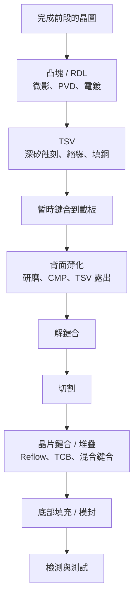

# 12. 設備深入（四）：先進封裝設備

> **一句話**：AI 晶片讓**先進封裝**成為半導體擴產重點。它把前段製程的技術（微影、電鍍、CMP、蝕刻）帶進封裝，再加上**薄化、切割、鍵合、模封**等專屬設備。設備工程師要同時懂**精密對位、溫度與壓力控制、翹曲與微粒管理**。

## 學習目標

- 分辨傳統封裝與先進封裝（扇出型、2.5D、3D、HBM）
- 理解先進封裝的主要製程與對應設備：凸塊、RDL、TSV、薄化、切割、鍵合、模封
- 比較 Mass Reflow、TCB、混合鍵合的差異
- 了解翹曲、對位精度、空洞、微粒等關鍵問題
- 認識主要設備廠商與台灣供應鏈

---

## 1. 封裝技術地圖 🟢

| 類型 | 說明 | 例子 |
|---|---|---|
| **打線（Wire Bond）** | 金屬線連接晶片與基板 | 成本低，仍大量使用 |
| **覆晶（Flip Chip）** | 晶片翻面，以凸塊直接連接基板 | 處理器、繪圖晶片 |
| **扇出型（Fan-out）** | 在晶片外重新佈線，免基板或薄基板 | **InFO**（台積電）、FOWLP |
| **2.5D** | 多顆晶片並排放在**中介層**（Interposer）上 | **CoWoS**（台積電），AI GPU + HBM |
| **3D** | 晶片直接垂直堆疊 | **SoIC**（台積電）、晶圓堆疊 |
| **HBM** | 多層 DRAM 堆疊，以 TSV 連接 | AI 加速器的高頻寬記憶體 |
| **面板級封裝（PLP）** | 以方形大面板取代圓形晶圓 | 提升面積利用率，發展中 |

- **Chiplet（小晶片）**：把大晶片拆成多顆小晶片，用先進封裝整合，提高良率與彈性；**UCIe** 是晶片間互連的開放標準
- 先進封裝的核心目標：**更高的互連密度、更短的傳輸距離、更好的散熱與供電**

## 2. 製程流程與設備 🟡

### 2.1 凸塊與重佈線（Bumping / RDL）

| 步驟 | 設備 |
|---|---|
| 晶種層 | PVD |
| 圖形化 | 塗佈、**封裝用曝光機**（步進機）、顯影；厚光阻 |
| 金屬成長 | **電鍍**：銅柱（Cu Pillar）、錫銀凸塊、RDL 銅線 |
| 去光阻與晶種蝕刻 | 濕式蝕刻 / 去光阻設備 |
| 回焊 | 回焊爐讓凸塊成形 |

- **微凸塊**（Micro-bump）間距越來越小，對電鍍均勻度、共面度要求越來越高

### 2.2 TSV（矽穿孔）

- **Bosch 深矽蝕刻**：交替進行 SF₆ 蝕刻與 C₄F₈ 鈍化，做出高深寬比的垂直孔洞，側壁有扇貝狀（Scallop）
- 孔內依序沉積**絕緣層（Liner）→ 阻障層 → 銅晶種**，再**電鍍填銅**
- 背面薄化後以 CMP 或蝕刻**露出 TSV（TSV Reveal）**

### 2.3 薄化、暫時鍵合與解鍵合

- **背面研磨（Back Grinding）**：把晶圓磨到很薄（數十微米），之後做應力消除（Stress Relief，如乾式拋光或 CMP）
- **TTV**（總厚度變異）是研磨關鍵指標
- 晶圓太薄無法單獨搬運，需先**暫時鍵合**到玻璃或矽載板，製程完再**解鍵合**（雷射、熱滑移、機械方式）

### 2.4 切割（Dicing）

| 方式 | 原理 | 特性 |
|---|---|---|
| **刀片切割（Blade）** | 鑽石刀片高速旋轉切割 | 成熟、成本低；有崩邊（Chipping）與刀痕寬度 |
| **雷射開槽 + 刀片** | 雷射先去除表面金屬與 Low-k 層 | 避免 Low-k 剝離 |
| **隱形切割（Stealth Dicing）** | 雷射聚焦在晶圓內部形成改質層，再擴張分離 | **無屑、無水、切割道窄**，適合薄晶圓與 MEMS |
| **電漿切割（Plasma Dicing）** | 以乾式蝕刻一次切開所有切割道 | 無崩邊、切割道窄、可做非矩形晶片 |

### 2.5 晶片鍵合與堆疊

| 技術 | 原理 | 特性 | 應用 |
|---|---|---|---|
| **Mass Reflow（MR）** | 放置晶片後整批過回焊爐 | 產能高；大晶片翹曲時容易接觸不良 | 一般覆晶 |
| **TCB（熱壓鍵合）** | 鍵合頭逐顆加熱加壓 | 精準控制溫度與壓力、適合細間距與薄晶片；產能較低 | **HBM 堆疊**、細間距凸塊 |
| **混合鍵合（Hybrid Bonding）** | 銅對銅 + 介電層對介電層**直接鍵合**，無凸塊 | **間距可縮到數微米以下**、互連密度極高、低電阻；要求極高的平坦度與潔淨度 | 3D 堆疊（如 SoIC）、影像感測器、新一代 HBM |

**混合鍵合流程**：CMP 平坦化（控制銅凹陷）→ 清洗 → **電漿活化**表面 → 對準貼合（介電層先鍵合）→ **退火**（銅膨脹接合）

- 型態分為**晶圓對晶圓**（W2W）與**晶粒對晶圓（D2W）**；D2W 可先挑選 KGD，但對位與潔淨度更困難
- HBM 堆疊常見技術有搭配非導電膜的 TCB、**MR-MUF**（回焊後模封填充）等，各記憶體廠路線不同，並評估導入混合鍵合

### 2.6 底部填充與模封

- **Underfill（底部填充）**：填入晶片與基板之間，分散熱應力、保護凸塊；空洞（Void）是主要缺陷
- **模封（Molding）**：大尺寸封裝常用**壓縮成型（Compression Molding）**
- **壓力烤箱 / 除泡設備**：在加壓環境下固化，減少空洞

### 2.7 檢測

| 檢測 | 用途 |
|---|---|
| **AOI（自動光學檢測）** | 表面缺陷、凸塊外觀 |
| **3D 量測** | 凸塊高度、共面度、翹曲 |
| **X-Ray** | 焊點空洞、橋接、對位 |
| **SAT / C-SAM（超音波）** | 內部脫層、底部填充空洞 |
| **紅外線（IR）檢測** | 穿透矽量測鍵合對位與空洞 |

## 3. 設備工程師的關鍵控制項 🟡

| 設備 | 控制重點 |
|---|---|
| **鍵合機（Bonder）** | **對位精度**（視覺系統校正）、鍵合頭**平整度與平行度**、溫度曲線、壓力校正、UPH |
| **研磨機** | 砂輪修整（Dressing）、厚度量測、TTV、晶圓破片 |
| **切割機** | 刀片磨耗與更換、切割道位置、崩邊大小、冷卻水 |
| **電鍍** | 鍍液管理、均勻度、凸塊高度與共面度 |
| **回焊爐 / 烤箱** | 溫度曲線（Profile）、氮氣氧含量、均溫性 |
| **混合鍵合** | **奈米級微粒控制**、表面活化、對位精度（次微米）、退火 |

## 4. 關鍵問題 🔴

| 問題 | 說明 | 對策方向 |
|---|---|---|
| **翹曲（Warpage）** | 不同材料熱膨脹係數不同，大尺寸封裝更嚴重 | 材料選擇、載板、製程溫度、TCB 取代 MR |
| **對位精度** | 間距越小要求越高 | 視覺系統校正、溫度穩定、機構剛性 |
| **空洞（Void）** | 底部填充、焊點、鍵合介面 | 製程參數、壓力烤箱、表面清潔 |
| **微粒** | 混合鍵合一顆微粒就造成大面積空洞 | 前段等級無塵室與清洗 |
| **良率累積** | 多顆晶片堆疊，任一顆壞就整組報廢 | KGD 測試、可修復設計 |
| **散熱** | 堆疊越多越難散熱 | 熱介面材料、結構設計 |
| **產能** | TCB、混合鍵合逐顆處理，UPH 是瓶頸 | 設備改良、多頭鍵合 |

## 5. 主要設備廠商（舉例）🟢

| 領域 | 廠商 |
|---|---|
| 研磨、切割 | **DISCO**、東京精密 |
| 鍵合（TCB / 混合鍵合 / 晶圓鍵合） | BESI、ASMPT、Hanmi、K&S、EV Group、SUSS MicroTec、TEL、Applied Materials |
| TSV 蝕刻、沉積、電鍍、CMP | Lam Research、Applied Materials、Ebara |
| 模封 | TOWA 等 |
| 檢測 | KLA、Camtek、Onto Innovation |
| **台灣供應鏈** | 弘塑、辛耘（濕製程）、均華（晶粒挑揀與黏晶）、志聖（烤箱與壓膜）、萬潤（點膠與檢測）、印能（除泡與壓力烤箱）等 |

> 先進封裝設備市場變化快，實際投資與供應商以各公司公告為準；面試前可查目標公司的年報與法說會資料。

---

## 動手練習

1. **畫流程圖**：用本章內容畫出 2.5D（如 CoWoS 類型）封裝的主要步驟，標出每步使用的設備。
2. **比較表**：自己整理 MR、TCB、混合鍵合三種技術的間距、產能、成本、良率挑戰比較。
3. **讀法說會資料**：閱讀一家台灣封裝或設備公司的最新法說會簡報，整理其先進封裝相關產品與擴產計畫。
4. **翹曲推理**：矽（低熱膨脹）與有機基板（高熱膨脹）黏在一起加熱後冷卻，畫出翹曲方向並說明原因。

## 面試常問

> 先試著自己回答，再對照參考解答。

### Q1. 為什麼 AI 晶片需要先進封裝？

AI 運算需要極高的**記憶體頻寬**與運算密度。單一大晶片受限於光罩尺寸與良率，而先進封裝能把 GPU / 加速器與多顆 **HBM** 緊密整合在中介層上，提供超短距離、超高密度的互連，同時透過 Chiplet 提高良率與設計彈性。

### Q2. TCB 和 Mass Reflow 的差別？

- **Mass Reflow**：晶片放置後整批經過回焊爐，產能高、成本低；但大尺寸或薄晶片在加熱時翹曲，容易造成焊點接觸不良
- **TCB**：鍵合頭逐顆加熱加壓，能控制溫度與壓力曲線、抑制翹曲，適合**細間距與薄晶片堆疊**（如 HBM）；缺點是產能較低、設備較貴

### Q3. 混合鍵合的優點與挑戰？

**優點**：無凸塊、銅對銅直接連接，間距可縮到數微米以下，互連密度大幅提升、電阻與寄生效應低、堆疊高度更薄。

**挑戰**：需要**奈米級平坦度**與銅凹陷控制（CMP）、**極嚴格的微粒控制**（一顆微粒造成大面積空洞）、次微米對位精度、D2W 產能與良率、退火溫度與材料相容性。

### Q4. 隱形切割和刀片切割的差別？

- **刀片切割**：鑽石刀片物理切割，需冷卻水，有崩邊與較寬的切割道
- **隱形切割**：雷射聚焦在晶圓內部形成改質層，再以擴膜分離，**無屑、無水、切割道窄、崩邊少**，適合薄晶圓與對污染敏感的元件；但對晶圓表面材料與雷射穿透條件有要求

### Q5. 鍵合機對位精度變差，你會怎麼查？

1. 用**標準校正片**確認是否為系統性偏移
2. 檢查視覺系統：鏡頭清潔、光源、相機校正
3. 檢查**溫度穩定性**：熱膨脹造成的漂移，機台暖機是否足夠
4. 檢查機構：鍵合頭平整度與平行度、平台、馬達與編碼器
5. 對照環境（溫濕度、震動）與 PM 紀錄

### Q6. 封裝翹曲會造成什麼問題？如何改善？

翹曲造成焊點**接觸不良或橋接**、搬運與吸附困難、後段組裝到電路板時良率下降。改善方式：選擇熱膨脹係數匹配的材料、使用加強框或載板、調整製程溫度曲線、改用 TCB 等局部加熱鍵合、優化模封材料與厚度。

## 常見誤解

- **「封裝是低技術的後段工作」**：先進封裝已使用微影、電鍍、CMP、蝕刻等前段等級技術，是 AI 晶片的關鍵瓶頸之一。
- **「混合鍵合會完全取代凸塊」**：不同應用有不同成本與良率考量，凸塊、TCB 與混合鍵合會長期並存。
- **「封裝設備工程師不需要懂前段」**：先進封裝的 TSV、RDL、CMP 與潔淨度要求，都需要前段的知識。

## 本章回顧

- 技術地圖：打線、覆晶、扇出型、2.5D（CoWoS）、3D（SoIC）、HBM、Chiplet / UCIe
- 流程：凸塊 / RDL → TSV → 暫時鍵合 → 薄化 → 解鍵合 → 切割 → 鍵合 → 填充 / 模封 → 檢測
- 鍵合三種：Mass Reflow（產能）、TCB（細間距、HBM）、混合鍵合（最高密度）
- 關鍵問題：翹曲、對位精度、空洞、微粒、良率累積、散熱
- 台灣先進封裝供應鏈與設備需求持續成長
