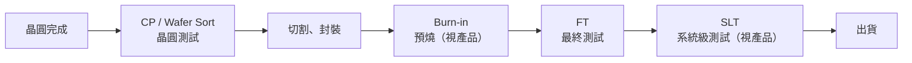

# 13. 測試與產品工程師：ATE、CP / FT 與良率分析

> **一句話**：每顆晶片出貨前都要經過**自動測試設備**（ATE）的測試。測試工程師寫測試程式、確保「壞的篩得掉、好的不誤殺」；產品工程師用測試數據追良率、降成本。這兩個職位**大量用到程式與資料分析**，是軟體背景進入半導體的另一個入口。

## 學習目標

- 說明晶片從晶圓到出貨的測試流程：CP、FT、SLT
- 理解 ATE、Probe Card、Handler、Load Board 等測試硬體
- 認識常見測試項目：Open / Short、漏電、IDDQ、功能、參數、Shmoo
- 理解 DFT（Scan、BIST、JTAG）在測試中的角色
- 運用良率、Bin、Wafer Map 與 STDF 資料進行分析

---

## 1. 職位與雇主 🟢

| 職位 | 常見雇主 | 主要工作 |
|---|---|---|
| **測試工程師（TE）** | 封測廠、IC 設計公司 | 開發與除錯測試程式、硬體（Load Board、Probe Card）、導入量產 |
| **產品工程師（PDE / PE）** | IC 設計公司 | 良率追蹤、Bin 分析、測試時間與成本優化、客退分析 |
| **測試設備工程師** | 封測廠 | ATE、Prober、Handler 的保養與故障排除（類似[第 08 章](08-equipment-engineering-practice.md)） |
| **ATE 原廠 AE** | Advantest、Teradyne 等 | 支援客戶開發測試程式、新平台導入 |

> 台灣封測產業規模大（日月光、矽品、京元電、力成等），IC 設計公司也都有產品與測試團隊，職缺穩定。

## 2. 測試流程 🟢

| 階段 | 測什麼 | 硬體 |
|---|---|---|
| **CP**（Chip Probing） | 在晶圓上逐顆測試，挑出壞晶粒，避免浪費封裝成本 | ATE + **Prober** + **Probe Card**（探針卡） |
| **FT**（Final Test） | 封裝後完整測試，含溫度（常溫、高溫、低溫） | ATE + **Handler**（取放機）+ **Load Board** + **Socket** |
| **Burn-in** | 高溫高壓下運作，篩除早期失效 | Burn-in 爐、Burn-in Board |
| **SLT**（System Level Test） | 放到接近真實系統中開機跑程式 | 客製化系統測試機 |

- **KGD（Known Good Die）**：HBM、Chiplet 等先進封裝要先確認每顆晶粒都是好的，CP 的重要性大增
- 主要 ATE 廠商：**Advantest**（如 V93000、T2000 系列）、**Teradyne**（如 UltraFLEX、J750 系列）；Prober 有 TEL、東京精密（Accretech）等

## 3. 常見測試項目 🟡

| 測試 | 目的 | 原理 |
|---|---|---|
| **Open / Short（Continuity）** | 確認接觸良好、腳位沒有開路或短路 | 透過腳位的 **ESD 保護二極體**灌小電流量電壓：正常約 0.2～0.8V（二極體壓降），接近 0V 為短路，達到鉗位電壓為開路 |
| **漏電（IIL / IIH）** | 輸入腳位漏電流是否在規格內 | 施加高 / 低電壓量電流 |
| **IDDQ** | 靜態電流，偵測製造缺陷 | 電路靜止時電流應極低，異常大代表有缺陷 |
| **DC 參數（VOH / VOL）** | 輸出電壓準位 | 帶負載量輸出電壓 |
| **功能測試** | 邏輯功能正確 | 送入測試向量（Pattern），比對輸出 |
| **AC / 時序** | Setup / Hold、傳遞延遲、最高頻率 | 改變時序參數掃描 |
| **類比 / 混合訊號** | ADC / DAC 的 INL、DNL、SNR | ATE 類比儀器 |
| **RF** | 輸出功率、EVM、靈敏度 | RF 儀器卡 |
| **記憶體測試** | 記憶體陣列功能 | MBIST，配合**修復（Redundancy Repair）** |

### Shmoo Plot

把兩個參數（例如**電壓 vs 頻率**）做二維掃描，標示每個組合 Pass / Fail，看出晶片的**操作視窗與餘裕**。用於特性分析（Characterization）與設定測試的 **Guardband**（保護帶）。

## 4. DFT：讓晶片可以被測 🟡

上億顆電晶體不可能從外部腳位完整測試，必須在設計時就加入測試電路：

| 技術 | 說明 |
|---|---|
| **Scan Chain** | 把正反器串成移位暫存器，可直接設定與讀出內部狀態 |
| **ATPG** | 自動產生測試向量，目標是高**故障涵蓋率**（如 Stuck-at、Transition Fault） |
| **BIST** | 晶片內建自我測試，常見 MBIST（記憶體）、LBIST（邏輯） |
| **JTAG / Boundary Scan**（IEEE 1149.1） | 標準測試存取介面，也用於板級測試與除錯 |

> 與軟體的對應：DFT 就像「為了可測試性而設計的程式架構」（依賴注入、Mock 介面），**不是事後補，而是設計時就要考慮**。

## 5. 測試成本與品質 🟡

**測試成本** ≈ ATE 機時費率 × 測試時間 ÷ 同測顆數，降低成本的方法：
- **多站並測（Multi-site）**：一次測 4、8、16 顆甚至更多
- **縮短測試時間**：刪除重複項目、調整等待時間、平行化測試
- **調整測試流程**：把部分項目從 FT 移到 CP，或用 BIST 取代外部測試

**品質權衡**：
- **Overkill（誤殺）**：好的被判壞，損失良率
- **Underkill（漏判）**：壞的流到客戶，造成客退（DPPM 上升）
- **Correlation（相關性）**：不同測試機、不同站點（Site-to-Site）、CP 與 FT 之間結果要一致
- **GR&R**（量測系統分析）：確認量測本身的重複性與再現性
- **PAT（Part Average Testing）**：車用常見，把雖在規格內但**明顯偏離群體**的晶片剔除（參考 AEC-Q001）

## 6. 良率與數據分析 🟡

### 6.1 Bin 與 Wafer Map

- **Bin**：測試結果分類。**Hard Bin** 對應實體分料（如 Bin 1 良品、其他不良），**Soft Bin** 細分失效原因
- **Wafer Map**：把每顆晶粒的 Bin 畫在晶圓位置上，**失效分布的形狀能指向製程問題**

| Wafer Map 圖形 | 可能原因 |
|---|---|
| 邊緣（Edge）集中 | 薄膜均勻度、蝕刻、CMP 邊緣效應 |
| 中心集中 | 塗佈、溫度分布 |
| 環狀 | 旋轉製程（塗佈、CMP、清洗） |
| 直線 / 刮痕 | 搬運刮傷、CMP 刮傷 |
| 重複性區塊 | 光罩缺陷（每次曝光都重複） |
| 隨機分布 | 微粒污染、隨機缺陷 |
| 特定 Site 偏高 | 探針卡某一站點接觸不良（測試問題，不是晶片問題） |

### 6.2 良率模型

- 簡化的 Poisson 模型：`Y = e^(−A × D)`（A：晶粒面積、D：缺陷密度），**晶粒越大，良率越低**，這也是 Chiplet 設計的動機之一
- 良率損失分成**系統性**（設計、製程視窗，有圖形）與**隨機性**（微粒）

### 6.3 資料格式與工具

- **STDF**（Standard Test Data Format）：ATE 輸出測試資料的業界標準格式
- 常見分析：Bin Pareto、良率趨勢、參數分布（直方圖、Cpk）、Wafer Map 疊圖、批次比較
- 工具：Python（pandas、matplotlib）、SQL、JMP，以及各公司的良率管理系統

> **軟體背景的優勢**：測試程式本身就是程式（如 C++ 開發環境），良率分析是資料工程，自動化報表與分析系統常由測試 / 產品工程師自己開發。

---

## 動手練習

1. **Wafer Map 分類**：使用公開的 **WM-811K** 晶圓圖資料集，用 Python 畫出各類失效圖形，並嘗試寫簡單的分類規則或模型。
2. **良率試算**：缺陷密度 D = 0.1 / cm²，比較晶粒面積 1cm² 與 4 顆 0.25cm²（Chiplet）的良率差異。
3. **解析 STDF**：用 Python 開源套件（如 `pystdf`、`Semi_ATE` 相關工具）讀取範例 STDF 檔，統計各 Bin 數量。
4. **畫 Shmoo**：用模擬數據（電壓 0.7～1.1V、頻率 1～3GHz，自訂通過條件）畫出 Shmoo Plot，標示操作視窗。

## 面試常問

> 先試著自己回答，再對照參考解答。

### Q1. CP 和 FT 的差別？

- **CP**：在晶圓階段用 Probe Card 逐顆測試，目的是**在封裝前挑出壞晶粒**以節省封裝成本，並回饋製程良率
- **FT**：封裝後用 Handler 與 Socket 測試，測試項目較完整（含溫度），確認**封裝後仍正常**並依規格分級出貨

部分項目只能在某一階段做（例如高頻、封裝相關的項目在 FT），測試策略要權衡成本與涵蓋率。

### Q2. Open / Short 測試的原理？

利用每個 I/O 腳位都有的 **ESD 保護二極體**：把電源接地，從腳位抽出（或灌入）小電流（如 100µA），量測電壓。正常會看到約一個二極體壓降（0.2～0.8V）；**接近 0V 代表短路**；**電壓達到儀器鉗位值代表開路**（接觸不良或打線斷）。這是每次測試最先執行的項目，確認接觸良好後才做後續測試。

### Q3. 良率突然下降，你怎麼分析？

1. **確認範圍**：特定批次、晶圓、測試機台、Probe Card、站點（Site），還是全面
2. **看 Bin Pareto**：哪個 Bin 增加最多
3. **看 Wafer Map**：失效分布有沒有特定圖形，對應到製程站點
4. **排除測試問題**：換測試機或 Probe Card 重測，比較 Site-to-Site 差異；若重測回升，屬測試問題
5. **與製程端合作**：比對該批次經過的機台、製程參數、FDC 資料
6. 確認根因後，提出對策並追蹤良率回復

### Q4. 什麼是 Overkill 和 Underkill？如何平衡？

- **Overkill**：好晶片被判壞，損失營收
- **Underkill**：壞晶片被判好，流到客戶造成客退與信譽損失

平衡方法：特性分析確認真實規格分布、設定合理 Guardband、確認測試機相關性與 GR&R、對可疑項目用重測或額外測試驗證。車用產品通常**寧可 Overkill**，並加上 PAT 篩除離群值。

### Q5. 如何降低測試成本？

- 增加**多站並測**數量
- 縮短測試時間：移除重複或低價值項目、優化等待時間、平行執行
- 測試流程最佳化：調整 CP / FT 分工、利用 BIST
- 提高良率與降低重測率
- 所有調整都要以**數據驗證不影響品質**（DPPM）

### Q6. 什麼是 Scan Chain？為什麼需要？

設計時把晶片內部的正反器串成**移位暫存器**。測試時切換到 Scan 模式，把測試向量移入，執行一個時脈週期後再把結果移出比對。這讓外部只用少數腳位就能控制與觀察內部大量邏輯，配合 ATPG 可以達到很高的故障涵蓋率。沒有 Scan，複雜晶片幾乎無法有效測試。

## 常見誤解

- **「測試只是按按鈕」**：測試程式開發、相關性分析、成本優化都需要深厚的電路與程式能力。
- **「良率低就是製程問題」**：探針卡、測試程式、Guardband 設定也會造成假性良率損失，要先排除測試端問題。
- **「規格內就該出貨」**：車用產品會用 PAT 剔除規格內的離群晶片，因為它們較可能早期失效。

## 本章回顧

- 測試流程：CP → 封裝 → Burn-in → FT → SLT
- 測試項目：Open / Short → 漏電 / IDDQ → 功能 → 參數 / 時序 → 類比 / RF
- DFT（Scan、ATPG、BIST、JTAG）讓複雜晶片可測
- 數據分析：Bin Pareto、Wafer Map 圖形判讀、良率模型、STDF，是軟體背景的強項
