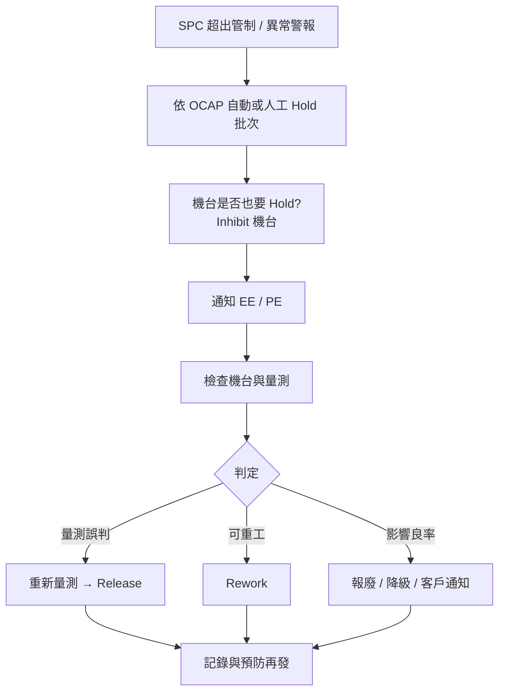

# 15. MFG 製造工程：產線管理、WIP 與生產週期

> **一句話**：製造部（MFG）是晶圓廠的「指揮中心」，目標是**準時、穩定、低成本地把貨做出來**。設備部讓機台能用、製程部讓配方正確，MFG 則決定**哪批貨、何時、在哪台機台跑**，並在異常發生時第一時間處置。核心觀念是 **WIP、生產週期、產能與派工**。

## 學習目標

- 了解 MFG 與 EE、PE、IE、生管、CIM 的分工
- 掌握晶圓廠的生產單位與批次類型：Lot、Route、Step、Hot Lot、Q-time
- 用 **Little's Law** 與 **X-factor** 理解 WIP 與生產週期
- 理解為什麼機台利用率不能衝到 100%（排隊理論）
- 熟悉派工規則、瓶頸管理與產線 KPI
- 能處理異常：Hold、OCAP、Q-time 超時、重工與報廢

---

## 1. MFG 在晶圓廠的角色 🟢

| 部門 | 主要負責 | 與 MFG 的關係 |
|---|---|---|
| **MFG（製造）** | 產線運作、出貨達成、派工、異常第一線處置、人員管理 | — |
| **EE（設備）** | 機台可用、保養、故障排除 | MFG 安排 PM 時段、通報當機 |
| **PE（製程）** | 配方、製程視窗、良率 | MFG 依 PE 規範處理 Hold 與異常批次 |
| **IE（工業工程）** | 產能規劃、機台數量、工時、成本 | 提供產能模型與目標 |
| **生管 / PC** | 生產計畫、投片、交期 | 決定投片量與優先順序 |
| **CIM** | MES、派工系統、自動化 | 提供系統與報表（見[第 16 章](16-cim-engineering.md)） |

**MFG 常見職位**：製造工程師、製造主任 / 值班主管（Shift Leader）、技術員（Operator / Technician）。製造工程師常負責一個區域（如黃光區、蝕刻區）的**產出達成、在製品平衡、異常處理、人員訓練與改善專案**。

## 2. 生產的基本單位 🟢

| 名詞 | 說明 |
|---|---|
| **Lot（批）** | 最小管理單位，300mm 廠常見一批最多 25 片（一個 FOUP） |
| **Route / Flow** | 一個產品要經過的完整步驟序列，先進製程可達上千步 |
| **Step / Operation** | 單一製程步驟，對應可用的機台群組與配方 |
| **WIP（在製品）** | 已投片但尚未完成的晶圓 |
| **Move** | 一批貨完成一個步驟稱為一個 Move，常用「每日 Moves」衡量產線產出 |
| **Out / 產出** | 完成全部流程出貨的晶圓數 |

**批次類型**：

| 類型 | 說明 |
|---|---|
| **一般生產批** | 依交期與規則派工 |
| **Hot Lot / Super Hot Lot** | 高優先權急件（新產品、客戶急單），可插隊甚至預留機台 |
| **工程批（Engineering Lot）** | 製程實驗、新產品驗證 |
| **監控片 / 假片（Monitor / Dummy）** | 機台監控、Seasoning、填補批次 |
| **重工批（Rework）** | 可回復的異常（如黃光重做） |

> Hot Lot 越多，一般批次的等待時間越長，且需要預留機台造成產能損失。**控制 Hot Lot 比例**是 MFG 的重要課題。

## 3. WIP 與生產週期 🟡

### 3.1 Little's Law

`WIP = 產出速率（Throughput） × 生產週期（Cycle Time）`

**例**：產線每天產出 1,000 片，WIP 為 30,000 片 → 平均生產週期 = 30,000 ÷ 1,000 = **30 天**。

意義：在產出速率不變下，**WIP 越多，生產週期越長**。盲目多投片不會讓產出變多，只會讓週期變長、交期變差。

### 3.2 生產週期的組成

`生產週期 = 實際加工時間 + 排隊等待 + 搬運 + Hold + 量測 + 批次等待`

- **X-factor**：`生產週期 ÷ 理論加工時間（Raw Process Time）`，衡量產線效率，數值越接近 1 越好；實務上常見數倍，依產品與策略而異
- **每層光罩週期（Cycle Time per Mask Layer）**：先進製程常用「每層光罩需要幾天」比較不同製程世代的週期
- 晶圓的大部分時間花在**排隊等待**，不是在機台裡加工

### 3.3 為什麼利用率不能衝到 100%

排隊理論的 **Kingman 近似式**：

`排隊時間 ≈ 變異係數項 × (U / (1 − U)) × 加工時間`

| 利用率 U | U / (1 − U) |
|---|---|
| 50% | 1 |
| 80% | 4 |
| 90% | 9 |
| 95% | 19 |

利用率越接近 100%，**排隊時間呈爆炸性成長**；變異（當機、到貨不均、批量大小）越大越嚴重。因此產能規劃會保留緩衝，並透過**降低變異**（提高 MTBF、縮短 MTTR、穩定到貨）來縮短週期。

> 這跟軟體系統的觀念一樣：伺服器 CPU 長期 95% 時延遲會飆升（參考 [SWEMindset 第 11 章](https://wyc915.github.io/SWEMindset/chapters/11-high-concurrency)）。

## 4. 派工與瓶頸管理 🟡

### 4.1 派工規則

| 規則 | 說明 | 適用 |
|---|---|---|
| **FIFO** | 先到先做 | 簡單、公平 |
| **優先權（Priority）** | 依批次等級（Hot Lot 優先） | 急件 |
| **EDD（最早交期）** | 交期越早越先做 | 準交率 |
| **CR（Critical Ratio）** | 剩餘時間 ÷ 剩餘所需加工時間，越小越急 | 綜合交期與進度 |
| **Q-time 優先** | 快超過 Q-time 的先做 | 避免報廢 |
| **Setup 最少化** | 相同配方或光罩的批次一起做 | 黃光換光罩、爐管批次 |

實務上由 **RTD**（Real-Time Dispatcher）系統綜合多種規則與權重自動排出派工清單，MFG 依現場狀況調整。

### 4.2 瓶頸與限制理論（TOC）

- **瓶頸（Bottleneck）**：產能最緊的機台群組，決定整條產線的產出（常見於黃光、特定蝕刻或量測）
- **瓶頸機台的一小時 = 整條產線的一小時**：瓶頸絕不能閒置或等料
- 做法：瓶頸前保留適量 **WIP 緩衝**、PM 排在低負載時段、瓶頸優先維修、避免瓶頸做重工

### 4.3 批次機台（Batch Tool）

爐管、濕式清洗槽一次處理多批。**等湊滿再做**可提高效率，但會增加等待時間；**不滿就做**減少等待但浪費產能。MFG 要依 WIP 狀況與 Q-time 決定。

## 5. Q-time 與異常處理 🔴

### 5.1 Q-time（Queue Time Constraint）

某些步驟之間有**最長等待時間限制**，例如清洗後要在一定時間內進爐管，否則表面重新氧化或吸附污染。

| 狀況 | 處置 |
|---|---|
| 快超過 Q-time | 派工系統提高優先權、預留機台 |
| 已超過 Q-time | 依規範 **Hold**，由 PE 判定重工（如重新清洗）或報廢 |
| 下游機台當機 | 停止上游投入，避免一批批超時（**Q-time 管控通常在進入區間前就要檢查**） |

### 5.2 Hold 與 OCAP

- **Hold**：批次暫停生產，原因包括 SPC 超出管制、機台異常、Q-time 超時、量測異常、工程需求
- **OCAP（Out of Control Action Plan）**：預先定義「異常發生時要做什麼」的處置流程

> 異常處理的原則：**先止血（停機台、Hold 批次）再查原因**，並確認同一段時間經過該機台的其他批次是否受影響（追溯範圍）。

## 6. 產線 KPI 🟡

| KPI | 意義 |
|---|---|
| **產出 / Moves** | 每日完成的晶圓數與步驟數 |
| **生產週期 / X-factor** | 速度與效率 |
| **準交率（On-time Delivery）** | 依承諾交期出貨的比例 |
| **WIP 水位與分布** | 是否有區域堆貨 |
| **Turn Rate** | 每日 Moves ÷ WIP，WIP 流動速度 |
| **機台利用率 / OEE** | 與 EE 共同追蹤（見[第 08 章](08-equipment-engineering-practice.md)） |
| **線上良率（Line Yield）/ 報廢率** | 製造過程中的損失 |
| **人員效率與誤操作次數** | 人員管理指標 |

## 7. 現場管理與改善 🟢

- **交接（Pass-down）**：輪班制下的交接紀錄，包含 WIP 狀況、當機機台、Hold 批次、待處理事項
- **SOP 與人員訓練**：技術員的操作認證，減少**誤操作（Misoperation）**
- **防呆（Poka-yoke）**：用系統檢查避免拿錯批、用錯配方（MES 與 EAP 的 Interlock）
- **改善手法**：精實生產（Lean）、六標準差（DMAIC）、5S、Pareto 分析
- **輪班**：晶圓廠 24 小時運作，常見 12 小時輪班等制度，依公司而異

---

## 動手練習

1. **Little's Law 練習**：產線產出每天 800 片，目標生產週期 40 天，WIP 應控制在多少？若 WIP 增加到 40,000 片且產出不變，週期變成多少？
2. **Kingman 體驗**：用 Python 模擬一台機台（加工時間 1 小時、隨機到貨），把到貨率從 50% 調到 95%，畫出平均等待時間曲線。
3. **派工規則比較**：設計 5 批貨（不同交期、剩餘步驟、Q-time），分別用 FIFO、EDD、CR 排序並比較結果。
4. **寫一份 OCAP**：針對「蝕刻後 CD 超出管制界限」寫出處置步驟、負責人與判定標準。

## 面試常問

> 先試著自己回答，再對照參考解答。

### Q1. 請解釋 Little's Law，以及它對產線管理的意義

`WIP = 產出速率 × 生產週期`。在產出速率受限於瓶頸產能時，**多投片只會增加 WIP 與生產週期**，不會提高產出。因此要依產能控制投片與 WIP 水位，並透過提高瓶頸產能、降低變異來縮短週期。

### Q2. 為什麼機台利用率不能拉到 100%？

根據排隊理論，等待時間約與 `U / (1 − U)` 成正比，利用率接近 100% 時排隊時間急劇上升；再加上當機、到貨不均等變異，會讓生產週期大幅延長、Q-time 超時增加。所以產能規劃要保留緩衝，並優先降低變異。

### Q3. Hot Lot 對產線有什麼影響？如何管理？

**影響**：一般批次被插隊、等待時間增加；預留機台造成產能損失；換線（Setup）增加。**管理**：限制 Hot Lot 比例與等級、明確定義申請與核准規則、用派工系統統一處理、追蹤 Hot Lot 對整體週期的影響並回饋給業務與生管。

### Q4. 某批貨 Q-time 超時，你怎麼處理？

1. 依規範立即 **Hold**，避免繼續流到下一站
2. 通知 PE 判定：可重工（如重新清洗）、可放行（在可接受範圍內）、或報廢
3. 追查原因：下游機台當機、派工未提高優先權、人員疏失
4. 檢查同時段其他批次是否也有風險
5. 改善：上游投入前檢查下游機台狀態、派工系統加入 Q-time 預警

### Q5. SPC 超出管制界限時，MFG 要做什麼？

依 **OCAP** 處置：Hold 受影響批次、必要時 Inhibit 機台、通知 EE / PE、確認量測是否正確、追溯同機台同時段的其他批次範圍、依判定結果放行 / 重工 / 報廢，最後記錄並預防再發。原則是**先止血再查原因**。

### Q6. 如何縮短生產週期？

- 控制 WIP 水位與投片節奏（Little's Law）
- 提高瓶頸產能、降低瓶頸閒置
- 降低變異：提高 MTBF、縮短 MTTR、PM 排程最佳化
- 減少 Hold 時間與重工、控制 Hot Lot 比例
- 優化派工規則與批次機台策略
- 減少搬運與量測等待（例如用虛擬量測減少實際量測，見[第 17 章](17-imc-smart-manufacturing.md)）

## 常見誤解

- **「多投片就能多產出」**：產出受瓶頸限制，多投只會讓 WIP 與週期增加。
- **「MFG 只是管人」**：MFG 需要懂排隊理論、派工邏輯、統計與數據分析。
- **「利用率越高越好」**：利用率太高會讓生產週期暴增，瓶頸以外的機台保留餘裕是正常的。

## 本章回顧

- MFG 決定「哪批貨、何時、哪台機台」，並負責異常第一線處置
- Little's Law：WIP = 產出 × 週期；X-factor 衡量效率
- 利用率接近 100% 時排隊時間爆炸，降低變異是關鍵
- 派工規則：FIFO、優先權、EDD、CR、Q-time；瓶頸絕不能閒置
- 異常處理：Hold → OCAP → 判定 → 追溯 → 預防；Q-time 要事前管控
