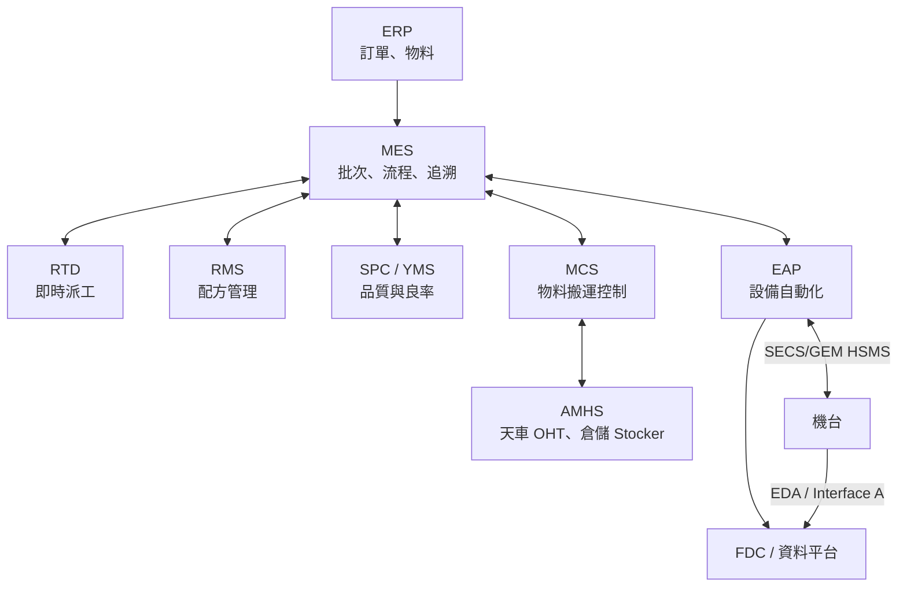
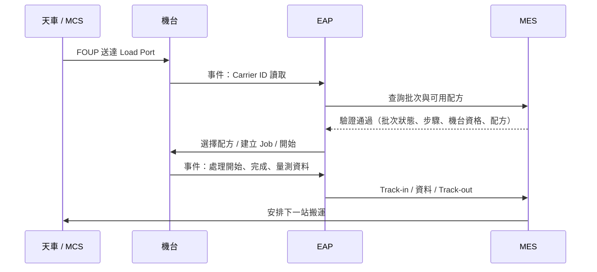
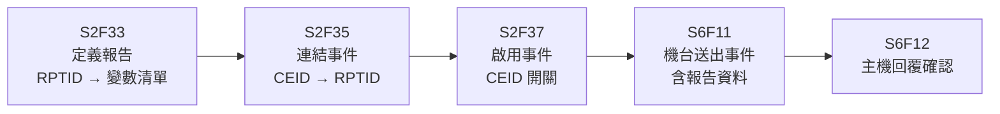
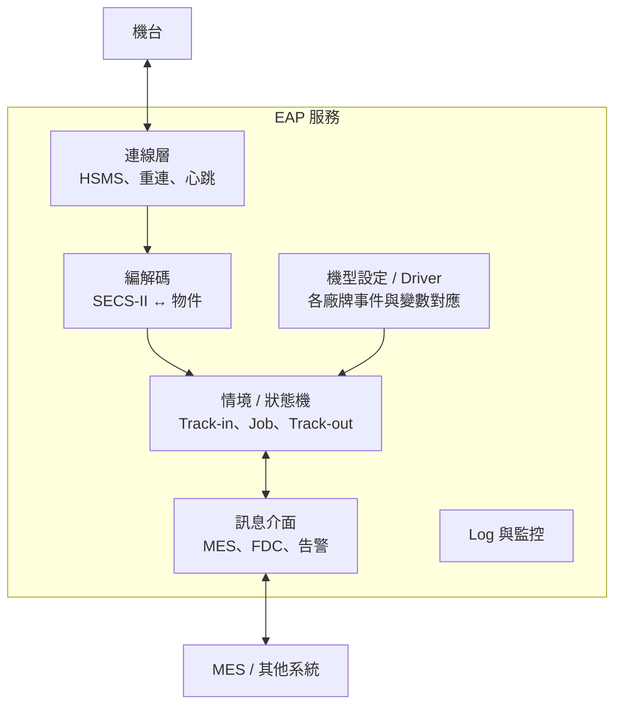

# 16. CIM 工程師：MES、EAP 與 SECS/GEM 實作

> **一句話**：CIM（Computer Integrated Manufacturing）團隊負責讓整座工廠「自動跑起來」的軟體：**MES 管批次流程、EAP 連接機台、RTD 派工、MCS 調度天車、RMS 管配方**。這是**軟體工程師最直接的轉職入口**，你熟悉的 .NET、資料庫、訊息佇列、高可用設計都能直接用上。

## 學習目標

- 畫出晶圓廠 CIM 系統全貌與 ISA-95 分層
- 說明 MES 的核心功能與 Track-in / Track-out 流程
- 理解 SECS-II 訊息結構、HSMS 連線與計時器、GEM 狀態模型
- 會設定事件報告（S2F33 / S2F35 / S2F37）並解讀 S6F11
- 設計一個可靠的 EAP：狀態機、冪等、逾時重試、高可用
- 排查連線中斷、事件漏報、配方不一致等常見問題

> 前置知識：[第 08 章](08-equipment-engineering-practice.md)的 SECS/GEM 標準家族；軟體基礎參考 [SWEMindset](https://wyc915.github.io/SWEMindset/) 的訊息佇列、分散式與高併發章節。

---

## 1. CIM 系統全貌 🟢

### 1.1 ISA-95 分層

| 層級 | 內容 | 晶圓廠對應 |
|---|---|---|
| **L4 企業層** | ERP、訂單、財務 | ERP、業務系統 |
| **L3 製造營運層** | 生產排程、批次管理、品質 | **MES、RTD、SPC、YMS、RMS** |
| **L2 監控層** | 監控與控制 | **EAP、FDC、MCS** |
| **L1 控制層** | PLC、機台控制器 | 機台軟體 |
| **L0 實體層** | 感測器、致動器 | 機台硬體 |

### 1.2 系統架構



| 系統 | 職責 |
|---|---|
| **MES** | 批次（Lot）追蹤、Route 與步驟管理、Track-in / Track-out、Hold / Release、資料收集、追溯 |
| **EAP** | 與每台機台的 SECS/GEM 通訊、執行自動化情境、把機台事件轉給 MES |
| **RTD（Real-Time Dispatcher）** | 依派工規則即時算出每台機台下一批要做什麼（見[第 15 章](15-mfg-manufacturing.md)） |
| **MCS（Material Control System）** | 下達搬運指令給天車與倉儲，管理 FOUP 位置 |
| **RMS（Recipe Management System）** | 配方版本、核准流程、與機台配方比對 |
| **SPC / FDC / YMS** | 品質管制、機台資料異常偵測、良率分析 |

- MES 可能是**商用產品**（如 Siemens Opcenter、Critical Manufacturing、Applied SmartFactory 等）或**自行開發**，大型晶圓廠常有大量自研系統
- 系統之間常透過**訊息匯流排**溝通（傳統如 TIBCO，新架構也使用 Kafka、RabbitMQ 等）

## 2. MES 核心流程 🟡



**Track-in 前的檢查（Interlock / 防呆）**：
- 批次是否在正確步驟、狀態是否為可生產（非 Hold）
- 機台是否具備該步驟資格（Qualification）且狀態正常（非 Inhibit）
- **配方名稱與內容是否與 RMS 核准版本一致**（Recipe Body Check）
- Q-time、光罩、耗材等限制

> 防呆是 CIM 的核心價值：**用系統阻止人為錯誤**，例如拿錯批、用錯配方。

## 3. SECS/GEM 實作細節 🔴

### 3.1 HSMS 訊息結構

| 欄位 | 長度 | 內容 |
|---|---|---|
| Message Length | 4 bytes | 後續長度 |
| Header | 10 bytes | Session ID（Device ID）、**W-bit + Stream**、Function、PType、**SType**、**System Bytes**（交易識別碼） |
| Data | 可變 | SECS-II 編碼的資料項目 |

- **SType**：0 = 資料訊息；其他為控制訊息，如 **Select**（建立會話）、**Linktest**（心跳）、**Separate**（中斷）
- **W-bit**：要求對方回覆
- **System Bytes**：用來配對請求與回覆，類似 Request ID
- 連線模式：**Active**（主動連線，通常是主機）/ **Passive**（等待連線，通常是機台）

### 3.2 HSMS 計時器

| 計時器 | 意義 | 常見預設 |
|---|---|---|
| **T3** | 等待回覆逾時 | 45 秒 |
| **T5** | 連線失敗後重試間隔 | 10 秒 |
| **T6** | 控制交易（如 Select、Linktest）逾時 | 5 秒 |
| **T7** | TCP 連上後未 Select 的逾時 | 10 秒 |
| **T8** | 訊息中字元間逾時 | 5 秒 |

### 3.3 SECS-II 資料格式（SML 表示法）

```text
S1F3 W
<L [2]
  <U4 1001>    // SVID：機台狀態
  <U4 1002>    // SVID：腔體溫度
>
```

常見資料型別：`L`（List）、`A`（ASCII）、`B`（Binary）、`BOOLEAN`、`U1 / U2 / U4 / U8`、`I1～I8`、`F4 / F8`。

### 3.4 GEM 狀態模型

- **通訊狀態**：Disabled → Enabled（Not Communicating → Communicating），以 **S1F13 / S1F14** 建立
- **控制狀態**：**Offline**（Equipment Offline / Attempt Online / Host Offline）與 **Online**（**Local** / **Remote**）
  - 只有 **Online Remote** 時主機才能遠端下指令
- **變數類型**：**SV**（狀態變數）、**DV**（資料變數，隨事件產生）、**EC**（設備常數，可設定）

### 3.5 事件報告設定流程



### 3.6 常用訊息速查

| 訊息 | 用途 |
|---|---|
| S1F1 / F2 | Are You There（連線測試） |
| S1F3 / F4 | 查詢狀態變數 |
| S1F13 / F14 | 建立通訊 |
| S1F15 / F17 | 要求離線 / 上線 |
| S2F13 / F15 | 查詢 / 設定設備常數 |
| S2F33 / F35 / F37 | 定義報告 / 連結事件 / 啟用事件 |
| S2F41 / F42 | 遠端指令（RCMD + 參數），回覆 HCACK |
| S5F1 / F3 | 警報報告 / 啟用警報 |
| S6F11 / F12 | 事件報告 |
| S7F3 / F5 / F19 | 配方下載 / 上傳 / 清單 |
| S10F3 | 終端訊息（在機台螢幕顯示文字） |

> GEM300 情境（E87 載具管理、E40 Process Job、E94 Control Job）在 300mm 廠中用來描述「哪個 FOUP 的哪幾片晶圓用哪個配方處理」，EAP 必須正確實作這些狀態機。

## 4. EAP 設計：軟體工程能力的主戰場 🔴

### 4.1 典型架構



### 4.2 設計重點

| 議題 | 做法 | 對應軟體觀念 |
|---|---|---|
| **每台機台一個狀態機** | 明確定義狀態與轉移，避免事件亂序時進入錯誤狀態 | 有限狀態機 |
| **冪等處理** | 重複收到同一事件（重送、重連後補送）不能重複 Track-out | Idempotency |
| **逾時與重試** | T3 逾時要有明確策略：重試、告警、人工介入 | Retry、Circuit Breaker |
| **訊息順序** | 同一機台的事件依序處理，不同機台平行處理 | 分區有序（類似 Kafka Partition） |
| **持久化** | 處理中的 Job 狀態要能在 EAP 重啟後恢復 | 狀態持久化、Outbox |
| **高可用** | Active-Standby 或多實例，故障時自動切換且不重複連線 | Failover、Leader Election |
| **可設定化** | 不同廠牌與機型的事件 ID、變數 ID 用設定檔管理，而非寫死 | 設定驅動、Plugin |
| **可觀測性** | 每筆訊息的 Log、延遲、錯誤率、連線狀態儀表板 | Logging、Metrics、Tracing |
| **測試** | 用**機台模擬器**與歷史 Log 回放做回歸測試 | 模擬器、Contract Test |

> 一座晶圓廠有上千台機台，EAP 是典型的**大規模、長連線、事件驅動的分散式系統**。你想學的 Kafka、K8s、CI/CD、高併發，在新一代 CIM 架構中都會用到。

### 4.3 開發技術

- 語言：**C# / .NET**（Windows 服務仍很常見）、Java、Python（工具與分析）
- 資料庫：Oracle、MSSQL、PostgreSQL；時序資料庫（FDC）
- 開源 SECS/GEM 函式庫可用於學習，例如 C# 的 `secs4net`、Python 的 `secsgem`
- 部署趨勢：從單機 Windows 服務走向**容器化與微服務**，但需考慮機台網路隔離與即時性

## 5. 常見問題與排查 🔴

| 現象 | 可能原因 | 排查 |
|---|---|---|
| **連線反覆中斷** | 網路、T7 / T6 逾時、Linktest 失敗、Device ID 不符、兩端同為 Active | 抓 HSMS 控制訊息、檢查計時器與模式設定 |
| **T3 逾時** | 機台忙碌、訊息格式錯誤被機台忽略、機台在 Online Local | 看機台控制狀態、比對訊息格式與規格書 |
| **事件漏報** | 報告未定義或未啟用、機台重開後設定遺失、EAP 例外吞掉訊息 | 重送 S2F33 / F35 / F37、檢查 EAP Log |
| **重複 Track-out** | 重連後事件重送、沒有冪等檢查 | 加上事件去重與狀態檢查 |
| **配方不一致** | 機台端被手動修改、RMS 版本未同步 | Recipe Body 比對、限制機台端修改權限 |
| **批次卡在機台** | Job 狀態機異常、MES 回覆逾時 | 對照機台與 MES 的狀態，提供人工復原工具 |
| **新機台導入延遲** | GEM 規格書不完整、事件與變數不清楚 | 導入前完成 **GEM Compliance 測試**與情境驗證 |

## 6. CIM 工程師的職涯 🟢

| 方向 | 內容 |
|---|---|
| **EAP / 設備整合** | 新機台導入、情境開發、連線穩定度 |
| **MES / 系統開發** | 生產流程、派工、追溯、報表 |
| **資料平台** | FDC、資料倉儲、即時資料管線 |
| **智慧製造 / AI** | VM、預測保養、AI 良率分析（見[第 17 章](17-imc-smart-manufacturing.md)） |
| **架構與 SRE** | 高可用、監控、系統效能 |

**優勢**：可接觸產線全貌，未來能轉向設備、製造、IE 或智慧製造；工作型態多為白天班加 On-call，比設備輪班規律（依公司而異）。

---

## 動手練習

1. **SECS 模擬器**：用 C# `secs4net` 或 Python `secsgem` 寫一個 Passive 機台模擬器與 Active 主機，完成 S1F13 建立通訊、S1F3 查詢、S2F41 遠端指令。
2. **事件報告**：在模擬器中實作 S2F33 / S2F35 / S2F37，讓機台在「處理完成」時送出 S6F11，主機解析並印出報告內容。
3. **EAP 狀態機**：用 C# 設計一個 Track-in → Processing → Track-out 狀態機，處理「重複事件」「逾時」「EAP 重啟」三種情境，並寫單元測試。
4. **畫系統圖**：畫出一批貨從投片到出貨經過哪些 CIM 系統、每個系統之間傳遞什麼資料。

## 面試常問

> 先試著自己回答，再對照參考解答。

### Q1. MES、EAP、RTD、MCS 的分工？

- **MES**：批次與流程的「帳本」，管理批次狀態、步驟、Track-in / out、Hold、追溯
- **EAP**：機台的「翻譯官」，透過 SECS/GEM 與機台通訊，執行自動化情境
- **RTD**：「調度員」，即時決定每台機台下一批做什麼
- **MCS**：「物流中心」，指揮天車與倉儲搬運 FOUP

### Q2. 說明 GEM 的控制狀態，為什麼主機有時無法下遠端指令？

GEM 控制狀態分為 **Offline**（Equipment Offline、Attempt Online、Host Offline）與 **Online**（Local、Remote）。只有在 **Online Remote** 時機台才接受主機的遠端控制指令；若機台被切到 Online Local（現場人員操作）或 Offline，主機的 S2F41 會被拒絕或沒有回應。排查時先用 S1F3 查詢控制狀態。

### Q3. 如何讓機台在特定事件時送出指定資料？

1. **S2F33** 定義報告：把要收集的變數（SVID / DVID）組成報告 RPTID
2. **S2F35** 連結事件：把報告綁到事件 CEID
3. **S2F37** 啟用事件
4. 事件發生時機台送出 **S6F11**（含 DATAID、CEID、報告內容），主機回 **S6F12**

建議在每次建立通訊後重新設定，避免機台重開後設定遺失。

### Q4. EAP 收到重複的處理完成事件，可能造成什麼問題？如何避免？

可能造成**重複 Track-out**、批次跳站、資料重複寫入。避免方式：
- 以「機台 + 批次 / Job ID + 事件類型」做**冪等檢查**
- 狀態機只在正確狀態接受事件（已完成就忽略）
- 處理結果持久化，重啟後依狀態恢復
- 記錄並告警異常重複事件以便追查

### Q5. HSMS 連線不穩定，你會怎麼查？

1. 確認雙方 **Active / Passive** 設定、IP / Port、**Device ID** 是否一致
2. 抓控制訊息：Select 是否成功、**Linktest** 是否逾時、是否有人送 Separate
3. 檢查計時器：T6、T7 是否設定太短
4. 網路：交換器、防火牆的 Idle Timeout、封包遺失
5. 機台端：軟體版本、是否同時有其他主機連線

### Q6. 如何設計高可用的 EAP？

- **Active-Standby** 或多實例搭配 **Leader Election**，確保同一台機台只有一個連線者
- Job 狀態與待處理訊息**持久化**，切換後能接續
- **冪等**處理事件，避免切換期間重送造成重複
- 健康檢查與自動告警，連線斷線自動重連
- 滾動更新：分批更新 EAP，避免全廠同時中斷
- 完整 Log 與監控（連線數、訊息延遲、錯誤率）

## 常見誤解

- **「CIM 只是寫報表」**：CIM 負責整座工廠的自動化與防呆，系統停擺會直接造成產線停止。
- **「SECS/GEM 很簡單，就是 TCP 收發」**：真正的難度在**各廠牌機台實作差異、GEM300 狀態機、可靠性與大規模運作**。
- **「CIM 工程師不需要懂製程」**：理解製程、設備與 MFG 的運作，才能設計出符合現場需求的系統。

## 本章回顧

- 系統全貌：ERP → MES / RTD / RMS / SPC → EAP / MCS / FDC → 機台（ISA-95 L4～L0）
- MES 流程：Carrier 讀取 → 驗證與防呆 → 配方 → 處理 → Track-out → 下一站搬運
- SECS/GEM：HSMS 訊息結構與計時器、GEM 控制狀態、S2F33 / F35 / F37 → S6F11
- EAP 設計：狀態機、冪等、逾時重試、順序、持久化、高可用、可設定化、模擬器測試
- CIM 是 .NET / 後端工程師最直接的半導體入口
