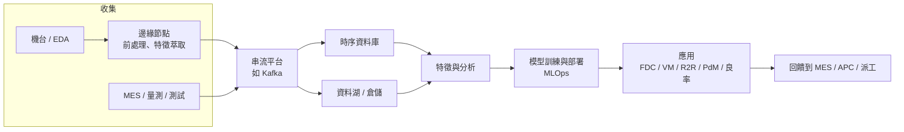
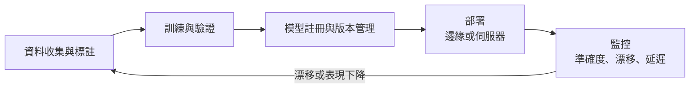

# 17. IMC 智慧製造：資料平台、AI 與工廠數位化

> **一句話**：智慧製造 / 整合製造單位（各公司名稱不同，如智慧製造中心、整合製造、數位轉型部門）把**機台資料、量測資料、生產資料**整合成平台，再用統計與 AI 做**虛擬量測、預測保養、良率分析、派工最佳化**。這是軟體、資料與 AI 背景在半導體業成長最快的職位。

## 學習目標

- 了解智慧製造單位的組成與常見職位
- 畫出晶圓廠資料平台架構：收集、儲存、處理、應用
- 理解主要應用：FDC、VM、R2R / APC、預測保養、AI 良率分析、ADC、派工最佳化
- 認識半導體資料的特性與 AI 落地的挑戰（資料漂移、不平衡、可解釋性）
- 了解 MLOps、邊緣運算與 LLM 在工廠中的應用與限制
- 規劃軟體背景切入智慧製造的路線

---

## 1. 智慧製造單位做什麼 🟢

| 職位 | 主要工作 | 技能 |
|---|---|---|
| **資料工程師** | 建立資料管線、資料湖 / 倉儲、即時串流 | SQL、Python、Kafka、Spark、資料建模 |
| **資料科學家 / AI 工程師** | 建立 VM、異常偵測、良率模型 | 統計、機器學習、深度學習、領域知識 |
| **MLOps / 平台工程師** | 模型部署、監控、再訓練流程 | 容器、K8s、CI/CD、監控 |
| **自動化 / 系統工程師** | 整合 MES、EAP、APC 與 AI 應用 | 後端開發、系統整合（見[第 16 章](16-cim-engineering.md)） |
| **數位轉型 PM / 顧問** | 盤點需求、定義專案價值、推動導入 | 溝通、製造知識、專案管理 |

> 智慧製造的價值不是「導入 AI」，而是**提升良率、縮短週期、減少停機、降低成本**。能把技術轉換成這些指標的人最搶手。

## 2. 資料從哪裡來 🟢

| 資料 | 來源 | 特性 |
|---|---|---|
| **機台感測器資料** | EAP、**EDA / Interface A**、FDC | 高頻時序（每秒數次到數百次）、量大 |
| **機台事件與警報** | SECS/GEM 事件、警報 | 離散事件 |
| **量測資料** | 膜厚、CD、Overlay、缺陷檢測 | 抽樣量測、延遲 |
| **生產資料** | MES：批次、步驟、機台、時間 | 追溯關鍵 |
| **測試資料** | CP / FT 的 Bin、參數、Wafer Map（見[第 13 章](13-test-product-engineering.md)） | 最終結果 |
| **影像** | 缺陷影像、SEM 影像 | 非結構化 |
| **設備維修紀錄** | PM、故障紀錄、零件更換 | 文字、半結構化 |
| **廠務資料** | 電力、超純水、氣體、溫濕度 | 環境因子 |

**半導體資料的特性**：
- **量大且多源**：需要跨系統用「批次 + 晶圓 + 步驟 + 機台 + 時間」串起來
- **標籤稀少且延遲**：良率結果可能要數週後才知道
- **不平衡**：異常樣本遠少於正常樣本
- **漂移（Drift）**：PM、耗材更換、配方調整都會改變資料分布
- **高度機密**：資料通常留在廠內，雲端使用受限

## 3. 資料平台架構 🟡

| 層 | 重點 |
|---|---|
| **收集** | EAP 與 EDA 收集高頻資料；**邊緣運算**在機台旁做前處理，降低傳輸量與延遲 |
| **傳輸** | 串流平台（如 Kafka）做緩衝與解耦 |
| **儲存** | 時序資料庫（感測器）、資料湖 / 倉儲（歷史與分析）、關聯式資料庫（生產資料） |
| **處理** | 資料清理、對齊（把感測器時序對應到每片晶圓的步驟）、特徵工程 |
| **應用** | 即時監控、模型推論、儀表板、回饋控制 |
| **治理** | 資料目錄、權限、品質監控、機密等級 |

> 這些就是你正在學的 Kafka、PostgreSQL、K8s、CI/CD、高併發與分散式架構，在晶圓廠的實際應用場景。

## 4. 主要應用 🔴

### 4.1 FDC（異常偵測與分類）

- 對每片晶圓的感測器時序取**特徵**（平均、最大、斜率、步驟時間），用統計管制或多變量模型偵測異常
- 方法：單變量 SPC、**多變量統計（如 PCA 搭配 T² 與 SPE 指標）**、機器學習異常偵測
- 挑戰：誤報太多會讓工程師「警報疲勞」，需持續調整門檻與分類

### 4.2 VM（虛擬量測）

- 用機台資料**預測量測結果**（如膜厚、CD），取代或減少實際量測
- 價值：每片都有預測值、縮短等待量測時間、更早發現異常
- 方法：迴歸模型（線性、樹模型、神經網路），需處理 PM 後的資料漂移
- 常與 **R2R** 結合：VM 預測值直接用來調整下一批參數

### 4.3 R2R / APC（批次間控制）

- 依前一批的量測或 VM 結果調整下一批參數，補償耗材磨耗與飄移
- 經典方法：**EWMA 控制器**，以加權平均估計製程偏移並修正
- 例：CMP 研磨時間依前批膜厚自動補償（見[第 11 章](11-cmp-equipment.md)）

### 4.4 預測保養（PdM）

| 層次 | 做法 |
|---|---|
| **事後維修** | 壞了再修 |
| **預防保養** | 依時間或用量定期保養（見[第 08 章](08-equipment-engineering-practice.md)） |
| **狀態監控** | 監控幫浦電流、震動、溫度等健康指標 |
| **預測保養** | 預測**剩餘壽命（RUL）**，在故障前安排保養 |

常見應用：真空幫浦、RF 產生器、機械手臂、ESC、MFC 的健康度預測。

### 4.5 AI 良率分析

- **Wafer Map 分類**：用影像分類模型（如 CNN）辨識失效圖形，對應製程問題
- **共通性分析（Commonality Analysis）**：找出不良批次共同經過的機台、腔體、時間點
- **ADC（自動缺陷分類）**：用模型分類缺陷影像，減少人工判讀
- **關鍵參數篩選**：從上千個參數中找出與良率相關的因子

### 4.6 派工與排程最佳化

- 用模擬或最佳化演算法改善 RTD 規則，目標是**縮短週期、提高準交率**（見[第 15 章](15-mfg-manufacturing.md)）
- **數位分身（Digital Twin）**：建立產線模擬模型，評估投片策略、機台配置、PM 排程的影響

### 4.7 LLM 與生成式 AI

| 應用 | 說明 | 注意 |
|---|---|---|
| **知識檢索（RAG）** | 查詢 SOP、維修手冊、歷史故障紀錄 | 回答要附來源，避免幻覺 |
| **故障排除助理** | 根據警報與 Log 建議可能原因 | 只能建議，決策與安全由工程師負責 |
| **報告與交接摘要** | 自動整理交接紀錄、8D 草稿 | 需人工審核 |
| **程式與查詢輔助** | 產生 SQL、分析腳本 | 權限控管 |

> 工廠的 LLM 通常要**部署在內部環境**，並嚴格管理資料權限與機密。

## 5. AI 落地的挑戰 🔴

| 挑戰 | 說明 | 對策 |
|---|---|---|
| **資料漂移** | PM、耗材、配方改變後模型失準 | 監控模型表現、定期或事件觸發再訓練 |
| **標籤不足 / 延遲** | 良率數週後才知道 | 半監督、異常偵測、遷移學習 |
| **類別不平衡** | 異常樣本極少 | 重新取樣、調整門檻、以成本為導向評估 |
| **可解釋性** | 工程師需要知道「為什麼」 | 特徵重要度、SHAP、規則化輸出 |
| **即時性** | 部分應用要在秒級內反應 | 邊緣推論、輕量模型 |
| **跨機台差異** | 同型號機台也有差異 | 依機台或腔體建模、遷移學習 |
| **導入阻力** | 工程師不信任模型 | 從輔助決策開始，用數據證明價值 |

### MLOps 流程

## 6. 軟體背景的切入路線 🟢

| 階段 | 建議 |
|---|---|
| **一、補領域知識** | 半導體製程（[07](07-semiconductor-process-equipment.md)）、設備與 SPC（[08](08-equipment-engineering-practice.md)）、MFG（[15](15-mfg-manufacturing.md)） |
| **二、資料能力** | SQL、Python（pandas、scikit-learn）、時序資料處理、統計 |
| **三、平台能力** | Kafka、PostgreSQL / 時序資料庫、Docker / K8s、CI/CD |
| **四、作品集** | 用公開資料集做 VM、異常偵測、Wafer Map 分類，並寫成完整專案（資料管線 + 模型 + 儀表板） |
| **五、入口職位** | CIM（[16](16-cim-engineering.md)）、資料工程師、智慧製造軟體工程師 |

**公開資料集**：UCI **SECOM**（製程感測器與良率）、**WM-811K**（Wafer Map）、NASA / PHM 社群的預測保養資料集（如渦輪引擎、軸承）。

---

## 動手練習

1. **VM 專案**：用 SECOM 資料集處理缺值、選特徵，建立分類或迴歸模型，評估在不平衡資料下的表現（Precision / Recall、混淆矩陣）。
2. **Wafer Map 分類**：用 WM-811K 訓練一個簡單的 CNN，比較各失效類別的辨識率。
3. **R2R 模擬**：用 Python 模擬一個每批漂移 0.5nm 的製程，實作 EWMA 控制器並比較有無控制的結果。
4. **串流管線**：用 Docker 架設 Kafka + PostgreSQL（或時序資料庫），寫一個模擬機台資料產生器，把資料寫入並做即時異常告警。

## 面試常問

> 先試著自己回答，再對照參考解答。

### Q1. 什麼是虛擬量測（VM）？有什麼價值與挑戰？

VM 用機台感測器資料與製程資訊**預測量測結果**。價值：每片晶圓都有預測值、減少量測成本與等待時間、更早發現異常、提供 R2R 控制即時輸入。挑戰：PM 與耗材更換造成**資料漂移**、量測標籤少、跨機台差異、預測錯誤可能影響生產決策，所以需要持續監控與再訓練。

### Q2. 預防保養和預測保養的差別？

- **預防保養**：依固定時間或用量保養，簡單但可能過度保養或來不及
- **預測保養**：依設備健康資料預測**剩餘壽命**，在故障前且最適當的時間保養，減少非計畫停機與不必要的保養

### Q3. 如何把機台的感測器資料對應到每片晶圓？

透過 EAP / MES 的事件與時間戳：晶圓進入腔體、配方步驟開始 / 結束等事件，把感測器時序依**機台、腔體、晶圓 ID、步驟、時間區間**切段，再萃取每段的特徵。資料對齊的正確性是所有分析的基礎，時鐘同步與事件完整性非常重要。

### Q4. 異常樣本很少，怎麼建模？

- 改用**異常偵測**（只學正常樣本的分布）
- 重新取樣（過取樣異常、欠取樣正常）或調整類別權重
- 以**業務成本**選擇門檻（漏判與誤報的代價不同）
- 評估指標用 Precision / Recall、PR 曲線，而不是準確率
- 結合領域知識設計特徵

### Q5. 模型上線後表現變差，你會怎麼處理？

1. 確認是否有**資料漂移**：PM、耗材、配方、量測機台變更
2. 檢查資料品質：缺值、對齊錯誤、感測器故障
3. 比較特徵分布與訓練時的差異
4. 依情況**再訓練**、依事件（如 PM）分段建模或加入狀態特徵
5. 建立監控與自動告警，避免下次太晚發現

### Q6. LLM 在工廠可以怎麼用？有什麼風險？

可用於 SOP 與維修手冊的**知識檢索（RAG）**、故障排除建議、交接與報告摘要、程式與查詢輔助。風險：**幻覺**（回答錯誤卻很有自信）、**資料外洩**（機密資料不能送到外部服務）、權限控管、過度依賴。對策：部署在內部環境、回答附來源、只作為輔助、關鍵決策與安全操作由工程師確認。

## 常見誤解

- **「導入 AI 就能提升良率」**：沒有乾淨、對齊、有領域意義的資料，模型毫無用處；資料平台通常比模型更花時間。
- **「準確率 99% 的模型很好」**：異常比例 1% 時，全部猜正常也有 99%，要看 Recall 與誤報成本。
- **「智慧製造只要會寫模型」**：需要懂製程、設備、MFG，並能與現場工程師合作才能落地。

## 本章回顧

- 智慧製造職位：資料工程、資料科學 / AI、MLOps、自動化整合、數位轉型 PM
- 資料來源：EDA / FDC、事件、量測、MES、測試、影像、維修紀錄；特性是量大、標籤延遲、不平衡、漂移、機密
- 平台：邊緣 → 串流 → 時序庫 / 資料湖 → 特徵 → 模型 → 回饋 MES / APC
- 應用：FDC、VM、R2R（EWMA）、預測保養、AI 良率分析、派工最佳化、LLM 知識檢索
- 軟體背景路線：補領域知識 + 資料能力 + 平台能力 + 作品集
